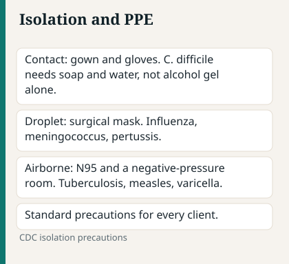
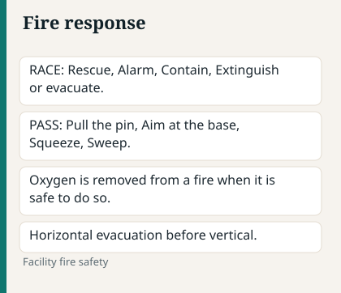

# Chapter 2 — Fundamentals & Safety

> **Study aid only.** Confirm isolation, med rights, and facility protocols with current CDC-aligned practice and your instructors. Not clinical protocol.

---

## Why it matters on NCLEX

Source: NCSBN/ANA National Guidelines for Nursing Delegation, 2019.

Safety and Infection Prevention is a large Client Needs slice. Many “priority” and “first action” stems are really **infection control, falls, med safety, consent, or environment** questions in disguise. Master these and you protect points across the whole exam.

---

## Topic A — Infection prevention & isolation

Source: CDC isolation precautions, 2007.

### Pathophysiology / concept

Source: CDC isolation precautions, 2007.

Infection control interrupts the chain of infection (infectious agent → reservoir → portal of exit → mode of transmission → portal of entry → susceptible host). **Standard precautions** apply to **every** client. Transmission-based precautions add barriers when the pathogen’s spread mode demands it.

### Assessment cues

Source: NPIAP pressure-injury staging, 2016.

- Fever, local redness/drainage, rising WBC (context-dependent)
- Clusters of similar illness on a unit (QI signal)
- Client risk: neutropenia, open wounds, invasive lines, age extremes

### Priority nursing actions

Source: NCSBN/ANA National Guidelines for Nursing Delegation, 2019.

1. Hand hygiene before/after every contact (and after glove removal).
2. Choose correct isolation category; post signage; stock PPE outside room.
3. Teach visitors; cohort only per policy.
4. For **C. difficile**: soap and water (spores); bleach-capable cleaning per policy — alcohol gel alone is not enough.
5. Don/doff in correct order; never “clean” your phone with contaminated gloves.

### Medications / treatments (high-yield)

Source: NCSBN RN Test Plan, 2026.

- Antibiotics: allergy history first; culture before first dose when ordered and client is stable enough.
- Antipyretics treat comfort — they do not replace source control.

### Client teaching

Source: NCSBN RN Test Plan, 2026.

- Cover cough; stay home when contagious (community key points).
- Don’t share personal items; complete antibiotic courses as prescribed.

### Safety / red flags

Source: CDC isolation precautions, 2007.

| Type | Classic organisms (high-level) | PPE / room highlight |
| --- | --- | --- |
| Standard | Everyone | Hand hygiene |
| Contact | C. diff, MRSA* | Gown + gloves |
| Droplet | Flu, N. meningitidis, many respiratory | Surgical mask **donned on room entry**; private room preferred; mask client for transport |
| Airborne | TB, measles | **N95** (fit-tested) + airborne infection isolation room (negative pressure, door closed) |
| Airborne **+ Contact** | Varicella, disseminated zoster | N95 + airborne room **+ gown and gloves** |

\*Follow current facility/CDC-aligned practice.

### Delegation notes

Source: NCSBN/ANA National Guidelines for Nursing Delegation, 2019.

UAP can often gather supplies and remind about hygiene on stable clients; **RN** decides isolation type and teaches complex infection risk (e.g., neutropenia).

### Remember this

Source: NCSBN/ANA National Guidelines for Nursing Delegation, 2019.

- Airborne = N95 + special room when indicated.
- C. diff = soap and water.
- Gloves do not replace hand hygiene.
- Isolation is a **priority** intervention when exposure risk is live.

---

## Topic B — Falls & restraints

Source: NCSBN RN Test Plan, 2026.

### Pathophysiology / concept

Source: NCSBN RN Test Plan, 2026.

Falls = leading hospital injury. Risk rises with age, confusion, meds (sedatives, antihypertensives), mobility aids, unfamiliar environment, and urgency to toilet. **Restraints** are a last resort after least-restrictive alternatives fail — they can cause injury, humiliation, and worse outcomes if misused.

### Assessment cues (early vs late)

Source: NCSBN RN Test Plan, 2026.

- **Early risk:** unsteady gait, “I need to get to the bathroom now,” new sedative, bed alarm ignored historically
- **Late/harm:** found on floor, head injury signs, fracture pain, sudden change in LOC after unwitnessed fall

### Priority nursing actions

Source: NCSBN/ANA National Guidelines for Nursing Delegation, 2019.

1. Universal fall precautions + targeted interventions (non-skid footwear, call light in reach, bed low, adequate lighting, toileting schedule).
2. Hourly rounding for high-risk clients.
3. Post-fall: ABCs, neuro check if head injury possible, notify provider, incident process per policy.
4. Restraints: least restrictive → order required (timing per policy) → assess circulation, skin, toileting, nutrition, release for ROM → document behavior that justified use and alternatives tried.

### Client teaching

Source: NCSBN RN Test Plan, 2026.

- Use call light before standing; sit at edge of bed first.
- Home: remove rugs, night lights, grab bars.

### Safety / red flags

Source: NCSBN RN Test Plan, 2026.

- Restraint as “convenience” or punishment = never.
- Soft wrist restraints still need frequent CMS checks.
- Chemical restraint mindset: sedating to control behavior without clinical indication is a safety/ethics issue.

### Delegation notes

Source: NCSBN/ANA National Guidelines for Nursing Delegation, 2019.

UAP can assist with ambulation of **stable** clients using proper technique and report near-falls; RN assesses fall risk and restraint necessity.

### Remember this

Source: NCSBN RN Test Plan, 2026.

- Least restrictive first.
- Restraints need orders, frequent checks, and a clear clinical reason.
- Toileting schedules prevent many “I fell trying to get to the bathroom” stems.

---

## Topic C — Medication rights & high-alert safety

Source: NCSBN RN Test Plan, 2026.

### Concept

Source: ADA Standards of Care in Diabetes, 2026.

Classic rights (person, med, dose, route, time — plus documentation, reason, response, education as taught in your program). High-alert meds (insulin, anticoagulants, opioids, chemo, concentrated electrolytes) need **independent double-checks** per policy.

### Priority actions

Source: NCSBN/ANA National Guidelines for Nursing Delegation, 2019.

1. Two client identifiers.
2. Allergy check — every time.
3. Clarify unclear orders; never assume.
4. Watch look-alike/sound-alike packaging.
5. After giving: evaluate response (pain relief? BP drop? glucose change?).

### Safety / red flags

Source: NCSBN RN Test Plan, 2026.

- Skipping ID because “I know this patient.”
- Trailing zeros / missing leading zeros in doses.
- IV push without checking compatibility/rate.

### Remember this

Source: NCSBN RN Test Plan, 2026.

If an option skips **allergy check**, **ID check**, or **compatible route/time**, it’s usually wrong.

---

## Topic D — Sterile technique & invasive device basics

Source: NCSBN RN Test Plan, 2026.

### Concept

Source: NCSBN RN Test Plan, 2026.

Sterile field protects sterile body cavities and devices. Clean technique reduces bioburden but is not sterile. Central lines and urinary catheters are major CLABSI/CAUTI prevention.

### Priority actions

Source: NCSBN/ANA National Guidelines for Nursing Delegation, 2019.

- Sterile: don’t turn back on field; 1-inch border contaminated; wet field = contaminated; above waist.
- Foley: sterile insertion; keep bag below bladder; closed system; peri care; remove ASAP when ordered/criteria met.
- Central line: aseptic hub scrub; dressing integrity; report fever/redness at site.

### Remember this

Source: NCSBN RN Test Plan, 2026.

Break in sterile field → stop and restart. Don’t “kinda” salvage it.

---

## Topic E — Informed consent & incident reports

Source: NCSBN RN Test Plan, 2026.

### Consent roles

Source: NCSBN RN Test Plan, 2026.

- **Provider** obtains informed consent (explain procedure, risks, benefits, alternatives).
- **Nurse** witnesses signature, verifies client understanding at a basic level, advocates if client is confused/coerced/has unanswered questions — **does not** replace the provider as primary educator of risks/benefits.
- Consent requires capacity; emergency exceptions exist per law/policy.

### Incident reports

Source: NCSBN RN Test Plan, 2026.

- Factual, objective, timely.
- Do **not** write “incident report filed” as a punitive narrative in the medical record progress note (follow facility charting rules).
- Purpose = safety/QI, not blame theater.

### Remember this

Source: NCSBN RN Test Plan, 2026.

Nurse witnesses/clarifies; provider informs. Incident reports feed QI.

---

## Topic F — Fire & disaster basics

Source: NCSBN RN Test Plan, 2026.

### Fire

Source: NCSBN RN Test Plan, 2026.

- **RACE:** Rescue → Alarm → Contain → Extinguish/Evacuate
- **PASS:** Pull → Aim → Squeeze → Sweep

### Disaster / triage (high-level)

Source: NCSBN/ANA National Guidelines for Nursing Delegation, 2019.

Mass casualty may shift from “sickest first” to **greatest good for greatest number** (expectant category exists in true disaster triage). Know your facility’s role; NCLEX usually tests recognition that priorities can differ from bedside ABC norms in declared disaster protocols.

### Remember this

Source: NCSBN/ANA National Guidelines for Nursing Delegation, 2019.

RACE/PASS are classic. Disaster triage ≠ everyday ED prioritization.

---

---

## Topic G — Pressure injury prevention & skin

Source: NPIAP pressure-injury staging, 2016.

### Concept

Source: NPIAP pressure-injury staging, 2016.

Pressure + shear + moisture → tissue ischemia. Staging 1–4 (+ unstageable, deep tissue pressure injury). Prevention is cheaper than treatment — and it’s a core safety quality metric.

### Priority actions

Source: NCSBN/ANA National Guidelines for Nursing Delegation, 2019.

- Turn q2h (individualize); offload heels; moisture management.
- Nutrition/protein; never massage reddened bony areas.
- Document size/stage carefully; wound photos per policy.
- Braden/risk tool on admission and regularly.

### Remember this

Source: NPIAP pressure-injury staging, 2016.

Red non-blanching over bone = stage 1 at minimum — intervene. Don’t stage what you can’t see (slough/eschar obscuring the base = unstageable). Do **not** remove stable, dry, adherent eschar on a heel or ischemic limb — it is protective; debridement only when ordered for unstable or infected wounds.

---

## Topic H — Pain vs oversedation

Source: NCSBN RN Test Plan, 2026.

### Concept

Source: NCSBN RN Test Plan, 2026.

Pain is real and deserves treatment; opioids still require RR/sedation monitoring. Pasero/sedation scales. Multimodal analgesia reduces opioid need.

### Priority actions

Source: NCSBN/ANA National Guidelines for Nursing Delegation, 2019.

- Assess pain with appropriate scale (numeric, faces, FLACC, PAINAD).
- Reassess after intervention.
- Hold opioids for oversedation/low RR per parameters; naloxone for overdose.
- Nonpharm: positioning, ice/heat as ordered, distraction.

### Remember this

Source: NCSBN RN Test Plan, 2026.

Treat pain and protect the airway. Sedation precedes respiratory arrest — watch the trend.

---

## Clinical judgment vignette 1 — Wrong isolation

Source: CDC isolation precautions, 2007.

**Stem:** Client coughing blood-tinged sputum, night sweats, weight loss; parked in double room; nurse about to use surgical mask only.

**What to do first:** Move toward airborne precautions pathway (N95 + airborne/negative-pressure room as indicated), mask client for transport, notify infection prevention/provider — don’t wait for “confirmed culture” if suspicion is high per protocol.

**Why:** Airborne exposure risk starts now. NCLEX rewards early correct isolation.

---

## Clinical judgment vignette 2 — Fall + toileting

Source: NCSBN RN Test Plan, 2026.

**Stem:** Confused elderly client on antihypertensives and zolpidem; repeatedly trying to climb out “to pee”; bed alarm sounding; UAP asks for soft restraints “so we can finish med pass.”

**What to do first:** Toilet now, bed low, non-skid footwear, closer observation/rounding, consider sitter or room near desk per policy — **restraints last**, not convenience during med pass.

**Why:** Toileting urgency is a top fall driver. Least restrictive alternatives first.

---

## Topic I — Neutropenic & protective environment

Source: NCSBN RN Test Plan, 2026.

### Concept

Source: NCSBN RN Test Plan, 2026.

Low ANC → infection risk from the environment and the client’s own flora. Fever in neutropenia is an emergency pathway (cultures + prompt antibiotics as ordered).

### Priority actions

Source: NCSBN/ANA National Guidelines for Nursing Delegation, 2019.

- Hand hygiene meticulously; limit visitors; no fresh flowers/plants per policy; safe food practices (follow facility neutropenic diet rules — they vary).
- Avoid rectal temps, IM injections when possible if platelets also low.
- Private room; HEPA/protective environments when indicated for profound neutropenia.
- Teach client to report fever, sore throat, new cough immediately.

### Red flag

Source: NCSBN RN Test Plan, 2026.

> **Red flag:** Neutropenic client with T 38.3°C (100.9°F) — don’t “recheck in 4 hours and hope.” Escalate per febrile neutropenia pathway.

---

## Topic J — Blood transfusion safety (fundamentals lens)

Source: NCSBN RN Test Plan, 2026.

### Priority actions

Source: NCSBN/ANA National Guidelines for Nursing Delegation, 2019.

1. Informed consent / type & crossmatch as ordered.
2. Two-nurse ID check at bedside per policy — unit to client.
3. Baseline VS; stay for first 15 minutes (or per policy); compatible NS only for priming/flush.
4. Reaction: **stop transfusion**, maintain IV with NS per protocol, notify provider/blood bank, save tubing/bag, VS, treat per reaction type (allergic, febrile, hemolytic, TACO/TRALI).

### Red flag

Source: NCSBN RN Test Plan, 2026.

> **Red flag:** Flank pain, fever, hypotension early in transfusion → stop; possible acute hemolytic reaction (ABO mismatch energy).

---

## Topic K — Body mechanics, transfers, and device safety

Source: NCSBN RN Test Plan, 2026.

- Wide base, lift with legs, don’t twist; use lift equipment — nurses’ backs matter and client falls during transfers are common stems.
- Bed to chair: non-skid footwear, lock brakes, gait belt as policy, stand on weak side as taught.
- Wheelchair: footrests, brakes when transferring.
- SCDs/TEDs: correct size; not on limbs with active DVT per typical practice; skin checks.

---

## Topic L — Sensory / seizure / aspiration environmental safety

Source: VA/DoD major depressive disorder guideline, 2022.

- Seizure pads, suction, O₂ ready when indicated.
- Aspiration: HOB↑ for meals, thicken only as ordered, chin tuck as taught by SLP.
- Sensory deficits: call light in reach of functional side; explain before touch; night lights.
- Suicide precautions environmental search when ordered (see psych chapter).

---

## Medication highlights tied to fundamentals safety

Source: NCSBN RN Test Plan, 2026.

| | Safety hook |
| --- | --- |
| Antibiotics | Allergy; culture timing; C. diff diarrhea reporting |
| Opioids | RR/sedation; naloxone; fall risk |
| Antihypertensives / diuretics | Orthostatics → falls |
| Anticoagulants | Bleed + fall = disaster; teaching |
| Sedative-hypnotics | Fall risk; confusion in elderly |
| Chemo | Spill kits; PPE; double-check |

---

## Concept check

Source: NCSBN/ANA National Guidelines for Nursing Delegation, 2019.

**Q1.** A client with suspected pulmonary TB is admitted. Which action is highest priority?
A. Private room with airborne precautions / N95 as indicated
B. Soft restraints
C. Clear liquid diet
D. Schedule teaching video first

**Q2.** Further teaching is needed when a UAP says:
A. “I’ll wash with soap and water after the C. diff room.”
B. “Alcohol gel alone is fine after C. diff care.”
C. “I’ll keep the Foley bag below the bladder.”
D. “Call light in reach for fall risk.”

**Q3.** A client needs surgery and asks the nurse to “explain all the risks like the surgeon should have.” Best action?
A. Provide full risk/benefit informed consent teaching yourself
B. Notify the provider to return and complete informed consent discussion
C. Have the UAP witness and sign
D. Cancel surgery without communication

**Q4.** During packed RBC transfusion, client develops fever, flank pain, and hypotension 10 minutes in. First action?
A. Slow the rate and reassure
B. Stop the transfusion, keep IV line open with NS per protocol, notify provider/blood bank
C. Give next unit faster to “get through it”
D. Ignore if only “a little” flank pain

**Q5.** Neutropenic client reports feeling cold; T 38.4°C. Priority ?
A. Extra blanket only; reassess tomorrow
B. Febrile neutropenia pathway — notify, cultures as ordered, prompt antibiotics as ordered
C. Send to gift shop for flowers to cheer up
D. Rectal temp to confirm twice

**Q6.** Best restraint practice statement?
A. Restrain first so med pass is faster
B. Least restrictive alternatives first; order, checks, toileting, documentation of behavior/alternatives
C. Vest restraint without assessment forever
D. Tie to side rails tightly for safety

#### Answers

**Q1: A.** Airborne isolation protects staff/others immediately.
**Q2: B.** C. diff spores need soap and water.
**Q3: B.** Provider obtains informed consent; nurse advocates for unanswered questions.
**Q4: B.** Stop transfusion first — possible acute reaction.
**Q5: B.** Fever + neutropenia = emergency pathway.
**Q6: B.** Least restrictive + legal/clinical process.

---

## Chapter Remember this

Source: CDC isolation precautions, 2007.

- Standard precautions for everyone; add transmission-based correctly.
- C. diff = soap and water; airborne = N95 + room.
- Falls: toileting + environment; restraints last resort.
- Med rights + allergy + high-alert double-checks.
- Consent = provider informs; nurse witnesses/advocates.
- RACE/PASS; incident reports = factual QI tools.
- Neutropenic fever and transfusion reactions = act now.
- Pressure injury prevention is a safety metric, not “optional comfort.”
