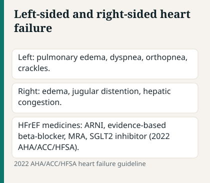
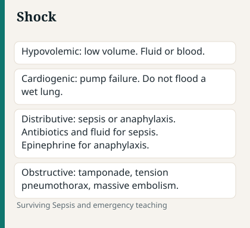

# Chapter 4 — Cardiac

> **Study aid only.** Cardiac protocols (ACS pathways, ACLS) follow facility/AHA-aligned standards. Labs/ranges vary.

---

## Why it matters on NCLEX

Source: 2025 ACC/AHA acute coronary syndromes guideline.

Cardiac items test **perfusion, oxygen supply/demand, fluid overload, and lethal rhythm urgency**. NGN cases love trending vitals, troponin, ECG changes, and response to nitro or diuretics. When stems feel “busy,” sort cues into **congestion vs hypoperfusion** and **stable vs unstable**.

---

## Topic A — CAD / ACS / MI

Source: 2025 ACC/AHA acute coronary syndromes guideline.

### Pathophysiology / concept

Source: 2025 ACC/AHA acute coronary syndromes guideline.

Coronary arteries supply myocardium. Atherosclerotic plaque → ischemia (stable angina with exertion) → plaque rupture/thrombus → **acute coronary syndrome** (unstable angina / NSTEMI / STEMI). Time is muscle: ischemic but still-viable myocardium in the border zone (area at risk) can be salvaged with timely reperfusion; delayed care enlarges infarct and raises arrhythmia, HF, and shock risk.

Supply–demand mismatch also drives demand ischemia (severe anemia, tachyarrhythmia, hypotension). NCLEX usually focuses on atherosclerotic ACS, but the same ABC and monitoring mindset applies.

### Assessment cues

Source: 2025 ACC/AHA acute coronary syndromes guideline.

**Early / typical:** chest pressure/pain ± radiation to arm/jaw/back, dyspnea, diaphoresis, nausea, sense of doom; women/diabetics/elderly may have atypical cues (fatigue, epigastric discomfort, dyspnea alone, “indigestion”).

**Concerning progression:** ongoing pain despite rest/nitro, hypotension, new crackles (LV failure), lethal arrhythmias, cardiogenic shock, new murmur (papillary muscle rupture / VSD post-MI).

**Labs/diagnostics:** 12-lead ECG urgently; serial troponin; CXR if HF suspected; prepare for cath lab when indicated.

### Priority nursing actions

Source: 2025 ACC/AHA acute coronary syndromes guideline.

1. ABCs; sit upright if dyspneic; O₂ **if hypoxic** per current protocol mindset (not automatic high-flow for every chest-pain client).
2. Continuous cardiac monitoring; **12-lead ECG urgently** — do not delay for lengthy history.
3. Notify provider / activate ACS pathway.
4. IV access; aspirin as ordered (chewable); nitroglycerin as ordered (watch BP; **hold if recent PDE-5 inhibitors** — sildenafil/tadalafil windows).
5. Morphine only as ordered for refractory pain — not a substitute for reperfusion strategy.
6. NPO if cath/possible intervention; prepare for reperfusion (PCI/thrombolysis eligibility concepts).
7. Comfort, anxiety reduction, and clear explanations reduce catecholamine surge.

### Medications / treatments (high-yield)

Source: 2025 ACC/AHA acute coronary syndromes guideline.

| Med | Nursing hooks |
| --- | --- |
| Antiplatelets (ASA, P2Y12) | Bleeding precautions; hold peri-procedure per orders |
| Anticoagulants in ACS | Protocol-driven; HIT/bleeding watch |
| Nitroglycerin | Vasodilation; HA/hypotension; no PDE-5 combo |
| Beta blockers | ↓ myocardial O₂ demand; watch HR/BP/bronchospasm |
| ACEI/ARB (post-MI/HF) | K⁺/Cr; cough/angioedema for ACEI |
| Statins | Long-term plaque stabilization; muscle sx reporting |
| Thrombolytics (selected STEMI) | Bleed risk; neuro checks for ICH |

### Complications to anticipate

Source: 2022 AHA/ACC/HFSA heart failure guideline.

- Arrhythmias (PVCs → VT/VF; bradycardia; heart blocks)
- Left ventricular failure / pulmonary edema
- Cardiogenic shock
- Mechanical complications (new murmur, sudden pulmonary edema) days after large MI
- Bleeding at PCI access site; retroperitoneal bleed (back/flank pain, hypotension)

### Client teaching

Source: 2025 ACC/AHA acute coronary syndromes guideline.

- Call emergency services for unrelieved chest pain (don’t drive yourself).
- Risk factor modification: smoking, lipids, HTN, diabetes, activity as cleared, cardiac rehab.
- Nitro storage/use teaching when prescribed (sit/lie; call EMS if pain persists after prescribed doses per teaching).
- Dual antiplatelet adherence after stent — premature stop = stent thrombosis risk.

### Safety / red flags

Source: 2022 AHA/ACC/HFSA heart failure guideline.

> **Red flag:** Sudden hypotension + tachycardia after nitro — stay with client, support ABCs, notify.
> **Red flag:** New loud murmur / flash pulmonary edema post-MI — mechanical complication until proven otherwise.
> **Red flag:** Expanding hematoma or unexplained hypotension after femoral access — escalate immediately.

### Delegation notes

Source: 2025 ACC/AHA acute coronary syndromes guideline.

UAP can report chest pain complaints immediately and obtain VS on stable clients; **RN stays with unstable ACS** clients, interprets ECG urgency, and titrates vasoactive/antianginal therapies per orders/policy.

### Remember this

Source: 2025 ACC/AHA acute coronary syndromes guideline.

- ECG + don’t leave unstable chest-pain clients alone.
- Aspirin/nitro per orders; watch BP and PDE-5 history.
- Atypical presentations still count — especially women, elderly, diabetics.

---

## Topic B — Heart failure (left vs right, congestion vs perfusion)

Source: 2022 AHA/ACC/HFSA heart failure guideline.

### Pathophysiology / concept

Source: 2025 ACC/AHA acute coronary syndromes guideline.

Pump failure → backup (**pulmonary congestion** in left-sided; **systemic edema**/JVD/hepatomegaly in right-sided) and/or poor forward flow (fatigue, oliguria, cool extremities, confusion). Compensatory SNS/RAAS worsen remodeling over time. Many clients have mixed pictures; chronic right-sided often follows left-sided disease.

| Feature | Left-sided HF | Right-sided HF |
| --- | --- | --- |
| Backup | Lungs | Systemic veins |
| Cues | Dyspnea, orthopnea, PND, crackles, pink frothy sputum (acute) | JVD, edema, weight gain, ascites, liver congestion |
| Forward fail | Fatigue, oliguria, cool skin, confusion | Same perfusion if severe |

### Assessment cues

Source: 2022 AHA/ACC/HFSA heart failure guideline.

**Congestion:** dyspnea, orthopnea, crackles, weight gain, edema, JVD, S3.
**Hypoperfusion:** cool clammy skin, hypotension, confusion, falling UOP, narrow pulse pressure.
**Acute decompensation:** pink frothy sputum = pulmonary edema emergency energy — ABC first.

### Priority nursing actions

Source: 2022 AHA/ACC/HFSA heart failure guideline.

1. ABCs; high Fowler’s; O₂ as indicated; consider NIV as ordered for flash edema.
2. Telemetry; **daily weights**; strict I&O; compare to dry-weight goals.
3. Diuretics as ordered; monitor K⁺ and BP; slow IV loop pushes per policy (ototoxicity).
4. Low-sodium diet teaching; fluid restriction if ordered.
5. Watch digoxin toxicity if applicable (GI, visual changes, bradycardia — confirm with levels/protocol).
6. Cluster care; reduce anxiety; elevate legs for edema when perfusion allows (not if severe pulmonary edema needing upright posture).

### Medications (high-yield)

Source: 2025 ACC/AHA acute coronary syndromes guideline.

- Loop diuretics (furosemide): K⁺ wasting; ototoxicity if pushed too fast IV
- ACEI/ARB/ARNI: cough/hyperkalemia/angioedema awareness for ACEI; ARNI washout after ACEI per protocol
- Evidence-based beta blockers in stable chronic HFrEF
- Aldosterone antagonists: K⁺ sparing — watch hyperkalemia with ACEI/ARB
- SGLT2 increasingly common in HF — genital infection / volume depletion counseling as ordered

### Client teaching

Source: 2025 ACC/AHA acute coronary syndromes guideline.

- Weigh daily — report gain per provider parameters (commonly ~2–3 lb in a day or ~5 lb in a week — follow specific teaching).
- Sodium awareness; med adherence; vaccines as advised.
- Know when to seek care (worsening dyspnea, orthopnea, swelling, sudden weight gain).
- Activity pacing; elevation of legs; skin care over edematous areas.

### Safety / red flags

Source: 2025 ACC/AHA acute coronary syndromes guideline.

> **Red flag:** Rapid weight gain + new orthopnea = decompensation — escalate, don’t “watch overnight” without reassessment.
> **Red flag:** Hypokalemia on loops → dysrhythmia / dig toxicity risk.
> **Red flag:** Confusion + cool clammy + falling BP = hypoperfusion — this is not “just anxiety.”

### Remember this

Source: 2025 ACC/AHA acute coronary syndromes guideline.

Daily weights are a vital sign in HF. Treat congestion and protect perfusion — they are not the same problem.

---

## Clinical judgment vignette 1 — Flash pulmonary edema

Source: 2022 AHA/ACC/HFSA heart failure guideline.

**Stem:** 72-year-old with HFrEF becomes acutely dyspneic; SpO₂ 86% on room air; pink frothy sputum; BP 168/98; HR 118; crackles throughout.

**What to do first:** Sit upright / high Fowler’s, apply O₂ per protocol, call for help/rapid response, continuous monitoring, prepare for IV diuretic and possible NIV as ordered — **do not** leave to “finish charting.”

**Why:** Airway/breathing and pulmonary edema are ABC emergencies. Congestion with hypertension often responds to upright posture, O₂, and diuresis/afterload reduction per orders; hypoperfusion shock would look different (low BP, cool clammy).

---

## Topic C — Hypertension & hypertensive crisis

Source: 2025 ACC/AHA acute coronary syndromes guideline.

### Concept

Source: 2025 ACC/AHA acute coronary syndromes guideline.

Sustained elevated BP damages vessels/organs (brain, heart, kidney, eye). **Hypertensive urgency** vs **emergency** (acute end-organ damage: encephalopathy, ACS, acute HF, aortic dissection, papilledema) drives how aggressively and how carefully BP is lowered.

### Assessment

Source: 2025 ACC/AHA acute coronary syndromes guideline.

Often silent; headache/vision changes/chest pain/neuro deficits/severe back pain (dissection pattern) = concerning. Accurate cuff size and technique matter — false highs from wrong cuff create noise.

### Priority actions

Source: AHA/ASA early management of ischemic stroke, 2019.

- Accurate BP technique; trend readings; both arms if dissection suspected.
- Meds as ordered; **slow controlled reduction** in emergencies per protocol (avoid crashing BP and watershed stroke).
- Lifestyle teaching: DASH/sodium, weight, alcohol, activity, smoking, adherence.

### Med

Source: 2025 ACC/AHA acute coronary syndromes guideline.

Diuretics, ACEI/ARB, CCB, beta blockers — hypotension/dizziness teaching; orthostatics; don’t stop clonidine abruptly (rebound HTN).

### Remember this

Source: 2025 ACC/AHA acute coronary syndromes guideline.

Lower BP safely; teach lifelong management; watch acute end-organ clues.

---

## Topic D — Shock overview (cardiac lens)

Source: 2025 ACC/AHA acute coronary syndromes guideline.

### Concept

Source: Surviving Sepsis Campaign, 2021.

Shock = inadequate tissue perfusion. Types: hypovolemic, cardiogenic, distributive (septic/anaphylactic/neurogenic), obstructive (PE/tamponade).

| Type | Sketch | Early nursing priorities |
| --- | --- | --- |
| Hypovolemic | Volume loss | Stop bleed/fluid replace per orders |
| Cardiogenic | Pump fail | Don’t drown with fluids; support BP/O₂; treat cause |
| Septic | Vasodilation/infection | Cultures, antibiotics, fluids per sepsis bundles |
| Anaphylactic | Allergy | Epinephrine IM, airway |
| Obstructive | Block | Relieve cause (e.g., tension PTX, tamponade) |

### Assessment cues

Source: 2025 ACC/AHA acute coronary syndromes guideline.

Tachycardia, hypotension, cool clammy (or warm in early distributive), oliguria, rising lactate, altered LOC, delayed CRT.

### Priority nursing actions

Source: NCSBN/ANA National Guidelines for Nursing Delegation, 2019.

1. Recognize shock early — trending BP/HR/UOP/LOC beats one snapshot.
2. ABCs; O₂; IV access; notify provider/rapid response.
3. **Match fluids to type** — cardiogenic and some obstructive states are not “wide-open fluids.”
4. Treat cause (stop bleed, antibiotics, epinephrine, reperfusion, needle decompression as scoped).

### Remember this

Source: 2025 ACC/AHA acute coronary syndromes guideline.

Treat cause + restore perfusion. Cardiogenic ≠ “just give lots of fluid.”

---

## Clinical judgment vignette 2 — Cardiogenic vs hypovolemic

Source: 2022 AHA/ACC/HFSA heart failure guideline.

**Stem:** Post-MI client: BP 82/50, cool clammy, crackles, JVD. UAP asks if they should hang a liter bolus “like last shock patient.”

**What to do first:** RN reassessment — this pattern fits **cardiogenic** shock (pump failure + congestion). Support ABCs, notify provider, prepare ordered inotropes/vasopressors/reperfusion support — **do not** automatically bolus large fluids.

**Why:** Wrong fluid strategy worsens pulmonary edema. Type of shock drives intervention.

---

## Topic E — Dysrhythmia nursing priorities

Source: NCSBN/ANA National Guidelines for Nursing Delegation, 2019.

### Concept

Source: 2025 ACC/AHA acute coronary syndromes guideline.

Electrical problems alter rate/output. Focus on **pulse presence, stability (BP, LOC, chest pain, dyspnea), and lethal rhythms**. Always treat the patient, not only the monitor strip.

### Priority actions

Source: AHA/ASA early management of ischemic stroke, 2019.

- Assess **patient**, not only the monitor (pulse check).
- Unstable tachycardia/bradycardia → rapid response / ACLS-aligned pathway.
- VF/pVT → CPR + defibrillation.
- Asystole/PEA → high-quality CPR + reversible causes (Hs/Ts mindset) — not defibrillation for asystole.
- Afib: rate control/anticoagulation stroke-risk as ordered.
- PVCs: treat causes (hypoxia, K⁺/Mg²⁺).

### Med

Source: AHA ACLS guidelines, 2025.

Amiodarone, adenosine, atropine, epinephrine — recognition of emergency use classes, not cookbook dosing from memory alone. Confirm ACLS/facility. Warn clients that adenosine causes brief asystole sensation.

### Remember this

Source: 2025 ACC/AHA acute coronary syndromes guideline.

No pulse + shockable lethal rhythm = CPR/defib energy. Stable vs unstable changes the pathway.

---

## Topic F — VTE / DVT / anticoagulation nursing

Source: 2025 ACC/AHA acute coronary syndromes guideline.

### Pathophysiology / concept

Source: ACOG Practice Bulletin 183 on postpartum hemorrhage, 2017.

Virchow’s triad: stasis, endothelial injury, hypercoagulability. DVT → PE risk. Orthopedic surgery, cancer, pregnancy/postpartum, estrogen, prior VTE, and immobility raise risk.

### Assessment cues

Source: 2025 ACC/AHA acute coronary syndromes guideline.

Unilateral leg swelling, pain, warmth, redness; Homans’ is unreliable — don’t rely on it. Sudden dyspnea/chest pain after DVT risk = PE until ruled out.

### Priority nursing actions

Source: NCSBN/ANA National Guidelines for Nursing Delegation, 2019.

- Prevention: early ambulation, SCDs on correctly (not on active DVT limb per typical practice), anticoag prophylaxis as ordered.
- Suspected DVT: don’t massage limb; elevate as ordered; prepare for duplex; anticoagulate as ordered.
- Bleeding precautions once anticoagulated; teach fall prevention.

### Medication monitoring hooks

Source: 2025 ACC/AHA acute coronary syndromes guideline.

| Agent | Monitor pattern |
| --- | --- |
| Heparin UFH | aPTT / anti-Xa; HIT risk |
| LMWH | Renal dosing; bleeding |
| Warfarin | INR; Vit K consistency; interactions |
| DOACs | Renal function; bleed precautions |

### Remember this

Source: 2025 ACC/AHA acute coronary syndromes guideline.

Prevention beats treatment. Unilateral swelling after surgery → take seriously.

---

## Topic G — Pacemaker / ICD key points

Source: 2025 ACC/AHA acute coronary syndromes guideline.

- Immobilize shoulder briefly as ordered post-implant; don’t raise arm above head initially.
- ID card; avoid strong magnets/MRI unless device-compatible.
- Report dizziness, persistent hiccups, or shocks (ICD).
- Microwaves usually fine; follow manufacturer teaching.
- At airport/security, inform agents; don’t linger in anti-theft gates.

### Remember this

Source: CDC isolation precautions, 2007.

Arm precautions early post-op; know when to report shocks.

---

## Clinical judgment vignette 3 — Unstable ACS

Source: 2025 ACC/AHA acute coronary syndromes guideline.

**Stem:** Client with crushing pain, diaphoresis, BP 88/54, HR 40s, pale. Monitor shows slow wide complex.

**What to do first:** Stay with client, support ABCs, activate emergency/ACS/rapid response, ensure defibrillator/pacing readiness per protocol, do **not** send ambulatory to XR alone, do **not** give nitro if profoundly hypotensive.

**Why:** Hypotension + bradycardia = unstable. Nitro would worsen BP. This is resuscitation + pathway activation, not routine med-surg choreography.

---

## Concept check

Source: 2025 ACC/AHA acute coronary syndromes guideline.

**Q1.** Client with crushing chest pain, diaphoresis, BP 88/50. First nursing action?
A. Detailed diet history
B. Stay with client, ABCs/monitoring, activate ACS/emergency response, do not leave
C. Ambulate to reduce anxiety
D. Give PO ibuprofen

**Q2.** HF teaching success looks like:
A. “I’ll avoid weighing myself so I don’t worry.”
B. “I’ll report a rapid weight gain and new orthopnea.”
C. “I can stop ACEI if I cough once.”
D. “Salt is fine if I drink more water.”

**Q3.** Monitor shows a lethal rhythm and client is unresponsive without pulse. Priority?
A. Obtain 12-lead before any action
B. Begin CPR and defibrillation per protocol
C. Call family first
D. Give oral beta blocker

**Q4.** Left-sided HF is most associated with:
A. Hepatomegaly and dependent edema only
B. Pulmonary crackles, orthopnea, dyspnea
C. Unilateral calf warmth alone
D. Petechial rash on palms

**Q5.** Client took sildenafil yesterday evening; now has chest pain. Nitroglycerin ordered. Best action?
A. Give nitro immediately — chest pain always wins
B. Hold nitro, clarify timing/contraindication with provider, support ABCs another way per orders
C. Give double nitro to overcome PDE-5
D. Crush sildenafil tablets for faster clearance

**Q6.** Post-PCI femoral site: sudden back pain, BP dropping, HR rising. Priority concern?
A. Anxiety only
B. Possible retroperitoneal bleed — stay, ABCs, notify provider, reinforce site per protocol
C. Encourage ambulation to cath lab café
D. Apply heating pad and chart later

#### Answers

**Q1: B.** Unstable ACS — stay, support ABCs, activate help.
**Q2: B.** Daily weight surveillance + symptom reporting.
**Q3: B.** Pulseless lethal rhythm → CPR/defib pathway.
**Q4: B.** Left-sided backup hits the lungs.
**Q5: B.** PDE-5 + nitro = dangerous hypotension risk — clarify/hold.
**Q6: B.** Hypotension + back pain post-femoral access = bleed until proven otherwise.

---

## Chapter Remember this

Source: 2025 ACC/AHA acute coronary syndromes guideline.

- ACS: time, ECG, aspirin/nitro per orders, watch BP and PDE-5 history.
- HF: weights, Na⁺, diuretics/K⁺, congestion vs hypoperfusion; left vs right tables.
- Shock: type drives fluids vs restraint of fluids.
- Dysrhythmias: pulse + stability first.
- VTE: prevent; don’t massage suspected DVT.
- New restlessness + falling SpO₂ / chest pain often outranks chronic stable complaints.
