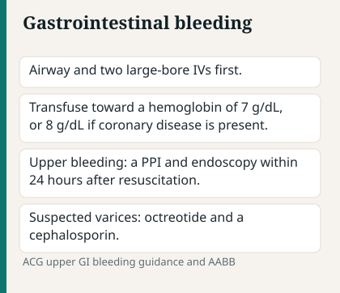

# Chapter 9 — GI & Hepatic

> **Study aid only.** GI bleed and liver failure management follow facility protocols. Not endoscopic procedure guidance.

---

## Why it matters on NCLEX

Source: NCSBN/ANA National Guidelines for Nursing Delegation, 2019.

GI/hepatic stems mix **ABCs (bleed, airway in hematemesis), neuro (encephalopathy), and fluid/electrolyte** judgment. Pancreatitis, obstruction, gallbladder disease, and feeding-tube safety add pain + shock + aspiration risk. Expect priority, SATA, and “what do you teach?” items.

---

## Topic A — GI bleed

Source: ACG GERD guideline, 2022.

### Pathophysiology / concept

Source: ACG GERD guideline, 2022.

Upper (PUD, varices, Mallory-Weiss, erosive gastritis) vs lower (diverticular, angiodysplasia, colitis, hemorrhoids). Blood loss → hypovolemic shock. **Esophageal varices** in portal hypertension can bleed torrentially — treat as ABC emergency until proven otherwise. Melena often points upper; bright hematochezia may be lower *or* brisk upper.

### Assessment cues

Source: ACG GERD guideline, 2022.

**Early:** restlessness, thirst, orthostatic dizziness, mild tachycardia.
**Progressing:** hematemesis, coffee-ground emesis, melena, hematochezia; cool clammy skin; oliguria; syncope.
**Late / shock:** hypotension, altered LOC, metabolic acidosis. Hgb drop **lags** acute bleed — don’t wait for labs if the client is crashing.

### Priority nursing actions

Source: NCSBN/ANA National Guidelines for Nursing Delegation, 2019.

1. ABCs — airway if vomiting blood; suction ready; NPO.
2. Two large-bore IVs; fluid/blood products as ordered; type & cross.
3. Continuous VS; stay with unstable client.
4. Notify provider; prepare for endoscopy / balloon tamponade as ordered.
5. Proton pump inhibitor infusion as ordered; **octreotide** for varices as ordered.
6. Avoid NSAIDs; reverse anticoags if ordered; bleeding precautions.

### Esophageal varices bleeding priorities

Source: NCSBN/ANA National Guidelines for Nursing Delegation, 2019.

- Volume + airway first; don’t leave client alone.
- Avoid straining, vomiting when possible (antiemetics as ordered); soft foods only when cleared.
- No blind NG placement in known varices unless ordered by experienced provider — facility rules apply.
- After bleed: lactulose if encephalopathy risk; alcohol cessation teaching; beta-blocker prophylaxis as ordered.

### Safety / red flags

Source: ACG GERD guideline, 2022.

- Bright red hematemesis + hypotension
- Known cirrhosis + bleed = varices until proven otherwise
- Rising HR before BP falls — early hypovolemia cue

### Remember this

Source: ACG GERD guideline, 2022.

Volume and airway first. Don’t feed an unstable bleeder. Varices = torrential bleed potential.

---

## Topic B — GERD, PUD & H. pylori

Source: ACG GERD guideline, 2022.

### Pathophysiology / concept

Source: ACG GERD guideline, 2022.

**GERD:** LES relaxation → acid reflux → esophagitis, Barrett risk long-term, aspiration risk if severe.
**PUD:** mucosal break in stomach/duodenum — *H. pylori* and NSAIDs are classic drivers; complications = bleed, perforation, obstruction (pyloric).

### Assessment cues

Source: ACG GERD guideline, 2022.

GERD: heartburn, regurgitation, worse after meals/lying flat, chronic cough/hoarseness.
PUD: epigastric pain — duodenal often relieved by food; gastric may worsen with food; melena/hematemesis if bleeding; rigid abdomen if perforation.

### Priority nursing actions / teaching

Source: NCSBN/ANA National Guidelines for Nursing Delegation, 2019.

- Elevate HOB; small meals; avoid late-night eating, alcohol, caffeine, peppermint, chocolate, fatty foods as individually trigger-linked.
- Sit upright after meals; smoking cessation.
- PPIs/H2 blockers as ordered — take PPI before meals per teaching.
- **H. pylori:** complete full antibiotic + PPI regimen (adherence prevents resistance/relapse).
- NSAID avoidance or gastroprotection per orders; report black stools / severe sudden pain.

### Safety / red flags

Source: ACG GERD guideline, 2022.

Sudden severe abdominal pain + board-like abdomen after PUD history = perforation → surgical emergency energy.

### Remember this

Source: ACG GERD guideline, 2022.

GERD = lifestyle + acid suppression. PUD bleed/perforation = ABCs and escalate. Finish *H. pylori* therapy.

---

## Topic C — Pancreatitis

Source: ACG GERD guideline, 2022.

### Pathophysiology / concept

Source: ACG GERD guideline, 2022.

Autodigestion of pancreas (gallstones/alcohol common). Cytokine storm → third-spacing, ARDS, hypocalcemia, hyperglycemia risk. Severity ranges from mild edematous to necrotizing.

### Assessment cues

Source: ACG GERD guideline, 2022.

**Early:** severe epigastric pain radiating to back, N/V, worse lying flat.
**Progressing:** fever, tachycardia, volume depletion.
**Concerning:** Cullen/Grey-Turner rare late; ↑ lipase/amylase; hypocalcemia tetany; dyspnea (ARDS).

### Priority nursing actions

Source: NCSBN/ANA National Guidelines for Nursing Delegation, 2019.

- NPO; aggressive IV fluids as ordered; pain control (often opioids).
- Antiemetics; glucose monitor; electrolyte replace.
- Position for comfort (fetal/side-lying).
- Watch ARDS/shock; ERCP if gallstone etiology.
- Advance diet slowly when pain/enzymes improve per orders; jejunal feeding sometimes used.

### Teaching

Source: ACG GERD guideline, 2022.

Alcohol cessation; low-fat diet when restarted; gallstone follow-up; report severe recurrent pain.

### Remember this

Source: ACG GERD guideline, 2022.

Rest the pancreas (NPO), fluids, pain control, watch calcium and lungs.

---

## Topic D — Cholecystitis & biliary colic

Source: ACG GERD guideline, 2022.

### Pathophysiology / concept

Source: ACG GERD guideline, 2022.

Gallstones (cholelithiasis) obstruct cystic duct → inflammation (**cholecystitis**). Fat intolerance common. Risk: “fair, fat, fertile, forty” is a mnemonic — not destiny. Choledocholithiasis / ascending cholangitis = fever, jaundice, RUQ pain (Charcot) — escalate.

### Assessment cues

Source: ACG GERD guideline, 2022.

RUQ / epigastric pain radiating to right shoulder/scapula, especially after fatty meal; N/V; fever; positive Murphy-type pain; dark urine/clay stools if CBD obstructed.

### Priority nursing actions

Source: NCSBN/ANA National Guidelines for Nursing Delegation, 2019.

- NPO if acute; IV fluids; analgesia; antiemetics; antibiotics as ordered.
- Prepare for cholecystectomy (lap); post-op: early ambulation, shoulder gas pain teaching, low-fat diet progression.
- T-tube care if present: drainage character/amount; keep bag below insertion; report sudden cessation or bilious peritonitis signs.

### Remember this

Source: ACG GERD guideline, 2022.

RUQ after fatty meal = biliary until proven otherwise. Fever + jaundice + pain = cholangitis concern — escalate.

---

## Topic E — Appendicitis vs peritonitis

Source: ACG GERD guideline, 2022.

### Pathophysiology / concept

Source: Surviving Sepsis Campaign, 2021.

Appendicitis: lumen obstruction → inflammation → possible rupture → **peritonitis**. Peritonitis = peritoneal inflammation from perforation, trauma, or spontaneous (ascites) — fluid shifts and sepsis risk.

### Assessment cues

Source: ACG GERD guideline, 2022.

**Appendicitis early:** periumbilical pain → migrates to RLQ (McBurney); anorexia, low-grade fever, rebound/guarding.
**Rupture / peritonitis:** pain may briefly ease then diffuse; rigid board-like abdomen, rebound, fever, tachycardia, absent bowel sounds, shock.

### Priority nursing actions

Source: Surviving Sepsis Campaign, 2021.

- NPO; IV access; no heating pads to abdomen (may ↑ perforation risk conceptually).
- Avoid laxatives/enemas if appendicitis suspected.
- Pain control after assessment baseline; prep for surgery.
- Post-rupture: antibiotics, drains, sepsis vigilance.

### Safety / red flags

Source: ACG GERD guideline, 2022.

Sudden relief of appendicitis pain can mean rupture — not “cured.” Rigid abdomen + fever = escalate now.

### Remember this

Source: ACG GERD guideline, 2022.

RLQ migratory pain = appendicitis pattern. Rigid abdomen = peritonitis emergency pattern.

---

## Topic F — Liver failure, ascites & hepatic encephalopathy

Source: ACG GERD guideline, 2022.

### Pathophysiology / concept

Source: ACG GERD guideline, 2022.

Liver fails to synthesize clotting factors/albumin, detoxify ammonia, handle bilirubin → coagulopathy, ascites/edema, jaundice, encephalopathy. Portal hypertension → varices/ascites. **Ascites** = fluid in peritoneum; large-volume **paracentesis** can drop BP — albumin as ordered.

### Assessment cues

Source: ACG GERD guideline, 2022.

Jaundice, ascites, spider angiomas, bruising/bleeding, asterixis, confusion/coma, fetor hepaticus; ↑ INR, ↑ bili, ↓ albumin, ↑ ammonia.

### Priority nursing actions

Source: NCSBN/ANA National Guidelines for Nursing Delegation, 2019.

1. Neuro checks; safety for confused clients.
2. Lactulose as ordered — goal is improved mentation / stooling per parameters.
3. Low-protein only if specifically ordered in acute encephalopathy (nutrition has nuance — follow orders).
4. Bleeding precautions; soft toothbrush; fall risk.
5. Ascites: sodium restriction, diuretics (spironolactone ± loop), measure abdominal girth/daily weight.
6. Paracentesis assist: void first if ordered; baseline VS; watch post-tap hypotension; sterile field; send fluid if infection suspected.
7. Avoid hepatotoxic meds/alcohol; dose-adjust drugs.

### Meds (high-yield)

Source: ACG GERD guideline, 2022.

- Lactulose / rifaximin for encephalopathy
- Vitamin K / FFP/blood products as ordered for bleed
- Spironolactone ± loop for ascites

### Client teaching

Source: ACG GERD guideline, 2022.

- Why lactulose matters (trap ammonia via stooling).
- No alcohol; med review; infection reporting (**SBP** risk with ascites — fever + abd pain).
- Skin care with jaundice/pruritus.

### Safety / red flags

Source: ACG GERD guideline, 2022.

- Sudden confusion in cirrhotic = encephalopathy until proven otherwise
- GI bleed in cirrhotic
- Fever + ascites = possible spontaneous bacterial peritonitis

### Remember this

Source: ACG GERD guideline, 2022.

Encephalopathy → lactulose + safety. Cirrhosis = bleed risk. Protect airway if obtunded. Post-paracentesis = watch BP.

---

## Topic G — Bowel obstruction

Source: ACG GERD guideline, 2022.

### Pathophysiology / concept

Source: ACG GERD guideline, 2022.

Mechanical (adhesions, hernia, tumor, volvulus) or paralytic ileus. Proximal dilation, vomiting, fluid shifts, ischemia/perforation risk → peritonitis.

### Assessment cues

Source: ACG GERD guideline, 2022.

Crampy pain, distention, vomiting (feculent if distal), high-pitched → absent bowel sounds progression, obstipation; XR/CT air-fluid levels.

### Priority nursing actions

Source: NCSBN/ANA National Guidelines for Nursing Delegation, 2019.

- NPO; NG decompression as ordered.
- IV fluids/electrolytes; pain control; antiemetics.
- Monitor for peritonitis (rigid abdomen, rebound, fever) → surgical emergency energy.
- Ambulation for ileus prevention post-op when appropriate.

### Remember this

Source: ACG GERD guideline, 2022.

NPO + decompress + fluids; peritonitis signs = escalate now.

---

## Topic H — Inflammatory bowel, diverticulitis, dumping & ostomy

Source: ACG GERD guideline, 2022.

### Ulcerative colitis vs Crohn’s (pattern)

Source: ACG GERD guideline, 2022.

UC: continuous colon, bloody diarrhea. Crohn’s: skip lesions anywhere, fistulas possible. Both: dehydration, anemia, infection risk with immunosuppressants/biologics.

### Diverticulitis

Source: ACG GERD guideline, 2022.

LLQ pain, fever; NPO/clear liquids as ordered; antibiotics; avoid barium/colonoscopy in acute flare per orders; watch perforation/abscess. Later: high-fiber teaching when stable (acute phase often low-fiber/NPO first).

### Dumping syndrome (post-gastrectomy high-yield)

Source: ADA Standards of Care in Diabetes, 2026.

Rapid gastric emptying → hyperosmolar load → fluid shift + reactive hypo.
**Cues:** diaphoresis, tachycardia, dizziness, diarrhea soon after meals; late hypoglycemia possible.
**Teaching:** small frequent meals; separate liquids from solids; high protein/fat, lower simple carbs; lie down after meals as taught; avoid extreme sweets.

### Ostomy care basics

Source: ACG GERD guideline, 2022.

- Stoma should be **pink/red and moist** — pale/dusky/black = perfusion emergency.
- Empty pouch when ~1/3–1/2 full; skin barrier integrity; measure wafer to fit closely.
- Ileostomy: liquid output, dehydration/electrolyte risk; colostomy: more formed distally.
- Psychosocial support; diet trial-and-error; gas/odor management teaching.

### Priority nursing actions (IBD flare)

Source: NCSBN/ANA National Guidelines for Nursing Delegation, 2019.

- I&O, electrolytes, skin care for diarrhea.
- Nutrition support; monitor for megacolon/perforation (distention, rigidity, shock).
- Immunosuppressant infection teaching.

### Remember this

Source: ACG GERD guideline, 2022.

Rigid abdomen in IBD/diverticulitis = perforation. Purple stoma = call now. Dumping = small meals, fluids between meals.

---

## Topic I — Hepatitis A/B/C teaching & precautions

Source: ACG GERD guideline, 2022.

### Concept

Source: CDC isolation precautions, 2007.

| Type | Transmission (exam lens) | Notes |
| --- | --- | --- |
| **A** | Fecal-oral (food/water, poor hand hygiene) | Vaccine; acute; hygiene teaching |
| **B** | Blood/body fluids, perinatal, sexual | Vaccine; chronic risk → cirrhosis/HCC |
| **C** | Blood (sharing needles historically high) | No vaccine; treatable with antivirals; chronic risk |

### Nursing priorities

Source: NCSBN/ANA National Guidelines for Nursing Delegation, 2019.

Standard precautions always; teach no sharing razors/needles/toothbrushes; safe-sex for B/C; hand hygiene for A; reportable diseases per public health; rest; avoid alcohol/hepatotoxins; vaccination for A/B when indicated.

### Remember this

Source: CDC isolation precautions, 2007.

Know transmission route for teaching and isolation decisions. Hep B vaccine protects; Hep C is blood-focused teaching.

---

## Topic J — TPN & enteral feeding safety

Source: ACG GERD guideline, 2022.

### Enteral (tube feeding)

Source: ACG GERD guideline, 2022.

- Confirm placement per policy before each use (x-ray initial; mark tube; residual/pH per protocol — follow facility).
- HOB ↑ ~30–45° during and after feeds to cut aspiration.
- Flush; check residuals as ordered; don’t mix meds into formula casually.
- Formula room-temp; change bags/tubing per policy; glucose/electrolyte/diarrhea monitoring.

### TPN (parenteral)

Source: ACG GERD guideline, 2022.

- Central line preferred for hypertonic TPN; dedicated lumen.
- Aseptic technique; filter as ordered; refrigerate unused; hang times limited.
- Monitor glucose (often q6h), electrolytes, infection (CLABSI), fluid balance.
- **Never** abruptly stop without dextrose plan — rebound hypo risk.
- If next bag late: per policy often D10 at same rate via central line until TPN arrives — know facility rule.

### Safety / red flags

Source: ACG GERD guideline, 2022.

Aspiration during tube feed; TPN bag with precipitates/cracks; fever in TPN client; sudden stop of TPN.

### Remember this

Source: ACG GERD guideline, 2022.

Enteral: HOB up + placement check. TPN: sterile + glucose + don’t stop cold.

---

---

## Additional clinical judgment vignettes — GI/hepatic

Source: ACG GERD guideline, 2022.

### Vignette A — Variceal bleed

Source: ACG GERD guideline, 2022.

**Stem:** Alcoholic cirrhosis; hematemesis; HR 130; BP 88/50.

**First:** ABCs, large-bore IVs, notify, type & cross, NPO, prepare octreotide/endoscopy pathway per orders — don’t give PO lactulose first while exsanguinating.

### Vignette B — Pancreatitis pain + hypovolemia

Source: ACG GERD guideline, 2022.

NPO, IV fluids, pain control, glucose/Ca²⁺ watch, ARDS/tetany red flags.

### Vignette C — Hepatic encephalopathy

Source: ACG GERD guideline, 2022.

New confusion + ↑ammonia context: safety, lactulose as ordered (titrate to stools per orders), infection hunt, no sedatives casually.

### Extra comparison

Source: ACG GERD guideline, 2022.

| Problem | Classic cue | First nursing pattern |
| --- | --- | --- |
| Appendicitis | RLQ, rebound, fever | NPO, surgery prep; sudden relief may = rupture |
| Peritonitis | Board-like abdomen, toxic | Fluids, Abx, surgery pathway |
| SBO | Distention, tinkling, bilious vomit | NPO, NG as ordered, fluids |
| Dumping | Post-gastrectomy postprandial crash | Small meals, separate fluids, lie down |

### Extra concept checks

Source: ACG GERD guideline, 2022.

**Q7.** Black tarry stools + coffee-ground emesis — priority mindset?
A. Encourage high-fiber snack first
B. ABCs, VS, IV access, notify — GI bleed until proven otherwise
C. Discharge with OTC iron only
D. Force ambulation without assessment

**Answer: B.**

## Concept check

Source: NCSBN/ANA National Guidelines for Nursing Delegation, 2019.

**Q1.** Client with hematemesis, HR 130, BP 86/50. First priority cluster?
A. Immediate cheeseburger for comfort
B. Airway/NPO, large-bore IV access, fluid resuscitation per orders, stay with client
C. Outpatient teaching pamphlet only
D. Ambulate to bathroom alone

**Q2.** Cirrhotic client becomes confused with asterixis. Expected ordered therapy ?
A. Lactulose to improve mentation
B. High-dose NSAIDs
C. Immediate high-protein binge without orders
D. Soft restraints as first line without assessment

**Q3.** Pancreatitis pain management and care includes:
A. Immediate high-fat feast
B. NPO, IV fluids, analgesia as ordered
C. Encourage alcohol “in moderation” tonight
D. Dry fasting without IV access

**Q4.** Client 2 weeks post-gastrectomy has diaphoresis, tachycardia, and diarrhea 20 minutes after a sugary meal. Best teaching emphasis?
A. Drink large fluids with every sweet meal
B. Small frequent meals, separate liquids from solids, limit simple sugars
C. Lie flat during meals and chug soda
D. Resume three large high-carb meals

**Q5.** Neutropenic precautions do **not** apply here — but which hepatitis teaching is correct?
A. Hep A: bloodborne only; ignore handwashing
B. Hep B/C: avoid sharing razors/needles; discuss transmission and vaccination (B) / treatment (C)
C. All hepatitis types are airborne — N95 always
D. Alcohol is encouraged in chronic Hep C

**Q6.** During large-volume paracentesis, priority nursing vigilance includes:
A. Encouraging a heavy meal mid-procedure
B. Baseline/ongoing VS, empty bladder if ordered, watch for post-tap hypotension
C. Removing albumin orders as irrelevant
D. Ambulating immediately if dizzy

#### Answers

**Q1: B.** Hypovolemic shock from GI bleed — ABCs/volume.
**Q2: A.** Hepatic encephalopathy — lactulose cornerstone.
**Q3: B.** Rest pancreas, fluids, pain control.
**Q4: B.** Classic dumping syndrome teaching.
**Q5: B.** Transmission-matched teaching; Hep B vaccine; Hep C blood-focused.
**Q6: B.** Paracentesis safety = VS + bladder + post-tap BP watch.

---

## Chapter Remember this

Source: ACG GERD guideline, 2022.

- GI bleed: ABCs and volume; NPO; varices can be torrential.
- GERD/PUD: lifestyle + PPI; finish *H. pylori* Rx; watch perforation.
- Pancreatitis: NPO, fluids, pain, Ca²⁺/lungs.
- Cholecystitis: RUQ after fat; cholangitis triad = escalate.
- Appendicitis → peritonitis: migratory RLQ then rigid abdomen.
- Liver: encephalopathy (lactulose), bleed risk, ascites/SBP, paracentesis BP.
- Obstruction: decompress; watch perforation.
- Dumping: small meals, fluids between; ostomy pink & moist.
- Hepatitis: know route; vaccines for A/B.
- Enteral HOB up; TPN sterile + glucose + no abrupt stop.
