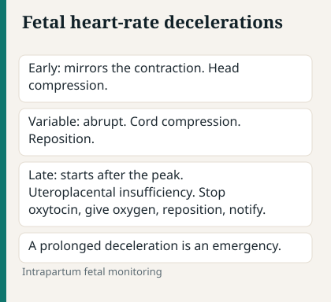
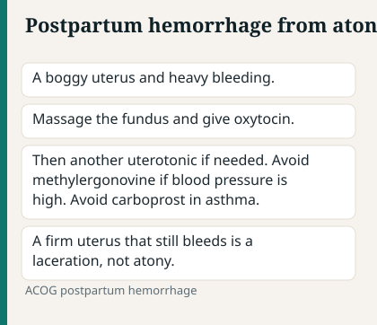
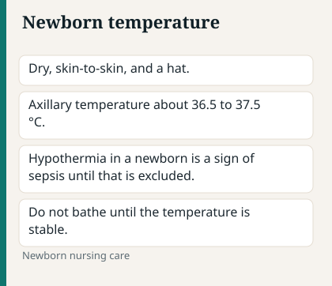

# Chapter 11 — Maternity & Newborn

> **Study aid only.** Obstetric emergencies follow facility/ACOG-aligned protocols. Not a substitute for obstetric clinical training. Medication use in pregnancy must be confirmed with current references.

---

## Why it matters on NCLEX

Source: AAP acute otitis media guideline, 2013.

Maternity items reward **pattern recognition under time pressure**: late decelerations, boggy fundus, magnesium toxicity, newborn thermoregulation. One correct priority action saves mother and baby in the stem — and in real life. NGN cases often unfold from subtle BP/proteinuria to seizure prophylaxis decisions.

---

## Topic A — Antepartum essentials

Source: ACOG Practice Bulletin 183 on postpartum hemorrhage, 2017.

### Pathophysiology / concept

Source: ACOG Practice Bulletin 183 on postpartum hemorrhage, 2017.

Pregnancy is a high-flow, high-volume state. Screening catches preeclampsia, GDM, anemia, infections. **Placenta previa** (painless bleeding, placenta over os) vs **abruption** (painful bleeding, board-like uterus) are classic contrasts. Ectopic pregnancy (first trimester pain + bleeding + shoulder pain) is a rupture risk.

### Assessment cues — prenatal danger signs (teach these)

Source: ACOG Practice Bulletin 183 on postpartum hemorrhage, 2017.

- Vaginal bleeding
- Severe headache, visual changes, epigastric/RUQ pain (preeclampsia)
- Decreased fetal movement
- Signs of preterm labor (regular contractions, pelvic pressure, fluid leak)
- Dysuria / fever
- Sudden swelling of face/hands
- Persistent vomiting with dehydration (hyperemesis complications)

### Priority nursing actions

Source: ADA Standards of Care in Diabetes, 2026.

- Accurate BP, urine protein, weight trends.
- Rh-negative clients: Rho(D) immune globulin timing concepts (28 weeks / after sensitizing events / postpartum if baby Rh+).
- GDM teaching: glucose monitoring, diet, insulin if ordered; fetal surveillance.
- Bleeding: assess amount, pain, VS; NPO; IV access; **no vaginal exams in suspected previa** until localization known.
- Kick counts teaching as ordered; when to call.

### Medication / treatment hooks

Source: ACOG Practice Bulletin 183 on postpartum hemorrhage, 2017.

Prenatal vitamins / folate (NTD prevention early); iron for anemia (take with vitamin C; constipation teaching); avoid ACEI/ARB/teratogens.

### Remember this

Source: ACOG Practice Bulletin 183 on postpartum hemorrhage, 2017.

Painless bleeding → think previa (don’t do vaginal exam). Painful rigid uterus → abruption energy.

---

## Topic B — Labor & fetal monitoring

Source: ACOG Practice Bulletin 183 on postpartum hemorrhage, 2017.

### Stages (nursing priorities)

Source: ACOG Practice Bulletin 183 on postpartum hemorrhage, 2017.

| Stage | What’s happening | Nurse focus |
| --- | --- | --- |
| 1 | Dilation | Comfort, hydration, monitor fetus/contractions, progress |
| 2 | Pushing → birth | Coach pushing, prepare for delivery, perineal support |
| 3 | Placenta | Watch separation signs, oxytocin as ordered, blood loss |
| 4 | Recovery (1–2 h) | Fundus, lochia, VS, bonding, hemorrhage vigilance |

### Fetal heart patterns

Source: ACOG Practice Bulletin 183 on postpartum hemorrhage, 2017.

| Pattern | Meaning pattern | First moves |
| --- | --- | --- |
| Accelerations | Generally reassuring | Continue surveillance |
| Early decelerations | Head compression — often benign mirror | Observe; document |
| Variable decelerations | Cord compression | Reposition; amnioinfusion as ordered |
| Late decelerations | Uteroplacental insufficiency | **Intervene now** |

### Priority actions for nonreassuring patterns (intrauterine resuscitation)

Source: NCSBN/ANA National Guidelines for Nursing Delegation, 2019.

Left lateral (or other position off vena cava), O₂ per protocol, stop oxytocin per protocol, IV bolus as ordered, notify provider, prepare for expedited delivery if unresolved. Check for tachysystole.

### Meds

Source: ACOG Practice Bulletin 183 on postpartum hemorrhage, 2017.

- Oxytocin: titration for labor; watch tachysystole and late decels — **stop per protocol** when fetus in trouble.
- Epidural: prehydrate as ordered; watch hypotension (left lateral, fluids, ephedrine/phenylephrine as ordered); bladder catheterization.
- Opioids in labor: watch for neonatal respiratory depression at birth — priority is airway positioning and **positive-pressure ventilation per NRP**. Naloxone is **not** part of initial neonatal resuscitation and is avoided in infants of opioid-dependent mothers (seizure risk).

### Remember this

Source: ACOG Practice Bulletin 183 on postpartum hemorrhage, 2017.

Late decels → act, don’t just document. Stop Pitocin per protocol when fetus is in trouble.

---

## Clinical judgment vignette 1 — Late decelerations

Source: ACOG Practice Bulletin 183 on postpartum hemorrhage, 2017.

**Stem:** Multipara on oxytocin; recurrent late decelerations; contractions every 1.5 minutes; client dizzy supine.

**What to do first:** Stop oxytocin per protocol, left lateral, O₂ as ordered, fluid bolus as ordered, notify provider — don’t increase Pitocin “to finish faster.”

**Why:** Tachysystole + lates = uteroplacental insufficiency pathway.

---

## Topic C — Postpartum hemorrhage (PPH)

Source: ACOG Practice Bulletin 183 on postpartum hemorrhage, 2017.

### Pathophysiology / concept

Source: ACOG Practice Bulletin 183 on postpartum hemorrhage, 2017.

**4 Ts:** Tone (atony — most common), Trauma (lacerations), Tissue (retained placenta), Thrombin (coagulopathy). Atony = boggy fundus. Risk: multiparity, macrosomia, twins, prolonged labor, magnesium, chorio, prior PPH.

### Assessment cues

Source: ACOG Practice Bulletin 183 on postpartum hemorrhage, 2017.

Saturating pads rapidly, boggy uterus, clots, hypotension/tachycardia, anxiety; may underestimate with slow steady loss — **quantify** (QBL). Fundus displaced up/right → full bladder.

### Priority nursing actions

Source: GINA strategy report, 2025.

1. Call for help / stay with client.
2. **Fundal massage** for boggy fundus.
3. Express clots; empty bladder (catheter if needed).
4. Oxytocin and other uterotonics as ordered (misoprostol, methylergonovine — **caution HTN**, carboprost — **caution asthma**).
5. IV access/fluids/blood products; O₂; second IV; labs/coags.
6. Prepare for balloon tamponade / OR / IR if refractory.
7. After stabilization: warm, emotional support, explain events.

### Safety / red flags

Source: ACOG Practice Bulletin 183 on postpartum hemorrhage, 2017.

> **Red flag:** Pad soaked in <15 minutes or large clots — massage and escalate.
> **Red flag:** Firm fundus + bright bleeding → think laceration/trauma, not more massage alone.
> **Red flag:** Giving methergine to client with BP 170/110.

### Remember this

Source: ACOG Practice Bulletin 183 on postpartum hemorrhage, 2017.

Boggy fundus → massage. Know uterotonic contraindications at a high level.

---

## Topic D — Preeclampsia / eclampsia / HELLP

Source: ACOG Practice Bulletin 183 on postpartum hemorrhage, 2017.

### Pathophysiology / concept

Source: 2022 AHA/ACC/HFSA heart failure guideline.

Hypertensive disorder of pregnancy with proteinuria/end-organ after 20 weeks (or postpartum). Severe features: high BP, thrombocytopenia, LFTs, creatinine, pulmonary edema, visual/neuro symptoms. Eclampsia = seizures. HELLP = hemolysis, elevated liver enzymes, low platelets — RUQ pain, nausea, DIC risk.

### Assessment cues

Source: ACOG Practice Bulletin 183 on postpartum hemorrhage, 2017.

Headache, visual changes, RUQ/epigastric pain, hyperreflexia/clonus, edema, ↓ UOP, fetal growth concerns, proteinuria, rising BP from baseline.

### Priority nursing actions

Source: 2022 AHA/ACC/HFSA heart failure guideline.

- Quiet room; seizure precautions; bed rest as ordered.
- **Magnesium sulfate** as ordered for seizure prophylaxis: monitor RR, DTRs, UOP, Mag levels; calcium gluconate antidote available.
- Antihypertensives as ordered.
- Delivery is definitive cure — timing per OB.
- Postpartum still at risk for days — continue vigilance; don’t assume “delivery fixed it” instantly.
- Strict I&O; lung sounds (pulmonary edema).

### Mag toxicity cues

Source: ACOG Practice Bulletin 183 on postpartum hemorrhage, 2017.

Loss of reflexes, ↓ RR (<12), ↓ UOP, extreme flushing, cardiac issues — **stop Mag**, give calcium gluconate per protocol, support airway.

### Remember this

Source: ACOG Practice Bulletin 183 on postpartum hemorrhage, 2017.

Mag: reflexes, respirations, urine output. Antidote = calcium gluconate. Headache/visual changes = take seriously.

---

## Clinical judgment vignette 2 — Mag toxicity

Source: ACOG Practice Bulletin 183 on postpartum hemorrhage, 2017.

**Stem:** Severe preeclampsia on mag; RR 10; DTRs absent; client drowsy; infusion still running.

**What to do first:** Stop mag, support airway/breathing, oxygen, calcium gluconate per protocol, notify provider — not “encourage ambulation to wake up.”

**Why:** Mag toxicity progresses to respiratory arrest.

---

## Topic E — Newborn care

Source: AAP acute otitis media guideline, 2013.

### Priority concepts

Source: ADA Standards of Care in Diabetes, 2026.

1. **Airway** — clear secretions as needed; skin-to-skin when stable.
2. **Thermoregulation** — dry thoroughly, hat, warmer/skin-to-skin; cold stress → hypoxia/hypoglycemia/acidosis cascade.
3. APGAR at 1 and 5 minutes (appearance, pulse, grimace, activity, respirations).
4. ID bands; security; delayed bathing as policy.
5. Vitamin K, eye prophylaxis as ordered.
6. Hypoglycemia risk: IDM, LGA/SGA, preterm, cold stressed — feed/protocols; heel-stick glucose.
7. Jaundice: physiologic after 24h vs pathologic earlier/rapid rise; phototherapy eye mask/hydration/temp.
8. Newborn screening / hearing / CHD pulse ox as applicable.
9. Cord care; circumcision care if done; feeding cues (rooting, hands to mouth).

### Assessment red flags

Source: ACOG Practice Bulletin 183 on postpartum hemorrhage, 2017.

Grunting, flaring, retractions; central cyanosis; temp instability; lethargy; sugar low; bilious vomiting; ambiguous genitalia with crisis risk (CAH high-level); no void/stool in expected windows per policy.

### Teaching

Source: ACOG Practice Bulletin 183 on postpartum hemorrhage, 2017.

Back to sleep (ABC: alone, back, crib); car seat rear-facing; feeding cues; cord care; when to call (fever, poor feeding, jaundice spreading, fewer wet diapers). Never shake. Smoke-free environment.

### Remember this

Source: ACOG Practice Bulletin 183 on postpartum hemorrhage, 2017.

Airway + warm + sugar. Pathologic jaundice early is concerning. Back to sleep.

---

## Topic F — Preterm labor & PROM / cord prolapse

Source: ACOG Practice Bulletin 183 on postpartum hemorrhage, 2017.

### Concept

Source: ACOG Practice Bulletin 183 on postpartum hemorrhage, 2017.

Contractions + cervical change before 37 weeks. PROM = membrane rupture before labor; PPROM if preterm. Infection (chorio) and cord prolapse risks. GBS status drives intrapartum antibiotic.

### Priority actions

Source: ACOG Practice Bulletin 183 on postpartum hemorrhage, 2017.

- Lateral position; tocolytics as ordered; antenatal corticosteroids for fetal lungs if indicated.
- Mag for neuroprotection in early preterm as ordered (different goal than preeclampsia dosing — follow OB orders).
- PROM: note time/color/odor of fluid; avoid unnecessary digital exams; monitor fetal tachy/maternal fever.
- **Cord prolapse:** knee-chest or Trendelenburg, lift presenting part off cord with gloved hand, O₂, emergency delivery prep — **do not** push cord back; keep hand in place until OR relief.

### Remember this

Source: ACOG Practice Bulletin 183 on postpartum hemorrhage, 2017.

Cord prolapse = relieve pressure, call for help, to OR. Steroids for fetal lung maturity when indicated.

---

## Topic G — Mastitis, endometritis, postpartum mood

Source: ACOG Practice Bulletin 183 on postpartum hemorrhage, 2017.

### Mastitis

Source: ACOG Practice Bulletin 183 on postpartum hemorrhage, 2017.

Unilateral red painful breast + fever; continue breastfeeding/pumping as advised; antibiotics; hydration; complete emptying.

### Endometritis

Source: ACOG Practice Bulletin 183 on postpartum hemorrhage, 2017.

Postpartum uterine infection: fever, foul lochia, uterine tenderness — antibiotics, Fowler’s, fluids; more common after cesarean.

### Mood

Source: ACOG Practice Bulletin 183 on postpartum hemorrhage, 2017.

| | Baby blues | Postpartum depression | Postpartum psychosis |
| --- | --- | --- | --- |
| Timing/pattern | Early days, mild, self-limited | Persistent, impaired function | Sudden, delusions/hallucinations |
| Action | Support, sleep, normalize | Screen, refer, treat, safety | **Emergency** — safety of mother/infant |

### Remember this

Source: ACOG Practice Bulletin 183 on postpartum hemorrhage, 2017.

Fever + uterine tenderness after birth ≠ ignore. Psychosis = safety first.

---

## Clinical judgment vignette 3 — Boggy fundus

Source: ACOG Practice Bulletin 183 on postpartum hemorrhage, 2017.

**Stem:** 45 minutes after vaginal birth; fundus boggy above umbilicus and displaced right; lochia soaking pad; BP 100/60 from 118/72.

**What to do first:** Fundal massage, call for help, empty bladder, uterotonics as ordered, IV access/fluids — don’t send to shower.

**Why:** Atony + full bladder classic; early PPH hypovolemia.

---

## Medication highlights (maternity)

Source: GINA strategy report, 2025.

| Med | Hook |
| --- | --- |
| Oxytocin | Tachysystole / fetal distress — stop per protocol; PPH first-line uterotonic |
| Mag sulfate | RR, DTRs, UOP; Ca gluconate antidote |
| Rho(D) IG | Rh-negative timing |
| Methergine | Avoid in hypertension |
| Carboprost | Avoid in asthma |
| Betamethasone | Fetal lung maturity |
| Terbutaline | Maternal tachy; limited use |

---

---

## Topic H — Gestational diabetes & hyperemesis (teaching depth)

Source: ADA Standards of Care in Diabetes, 2026.

### GDM

Source: ADA Standards of Care in Diabetes, 2026.

Insulin resistance of pregnancy → maternal hyperglycemia → fetal hyperinsulinemia → macrosomia, birth trauma, neonatal hypoglycemia. Teaching: carb awareness, glucose log, after-meal targets per OB, exercise as cleared, fetal kick counts, when insulin is added. Postpartum: screen for ongoing diabetes; breastfeeding usually encouraged.

### Hyperemesis gravidarum

Source: NCSBN/ANA National Guidelines for Nursing Delegation, 2019.

Persistent vomiting with weight loss/electrolyte imbalance/dehydration — not “normal morning sickness.” Priorities: IV fluids, electrolytes, antiemetics as ordered, thiamine before glucose if prolonged starvation risk (Wernicke), small frequent bland intake when able, emotional support (often dismissed unfairly).

---

## Topic I — Cesarean & postpartum infection prevention

Source: ACOG Practice Bulletin 183 on postpartum hemorrhage, 2017.

- Incentive spirometry, early ambulation, SCDs, incision assessment (REEDA).
- Lochia progression: rubra → serosa → alba; foul odor/fever = report.
- Rhogam if indicated; rubella vaccine postpartum if nonimmune (avoid pregnancy per teaching window).
- Contraception counseling before discharge when appropriate; pelvic rest teaching per OB.

## Concept check

Source: NCSBN/ANA National Guidelines for Nursing Delegation, 2019.

**Q1.** Late decelerations appear with oxytocin running. Best cluster?
A. Increase oxytocin and leave
B. Stop oxytocin per protocol, reposition (left lateral), O₂ as ordered, notify provider
C. Start pushing immediately regardless of dilation
D. Ignore — lates are always early decels

**Q2.** Boggy fundus and heavy lochia 1 hour after birth. First action?
A. Fundal massage and call for help
B. Ambulate to shower
C. Give ice chips only
D. Document without intervening

**Q3.** Client on mag sulfate has RR 10 and absent DTRs. Priority?
A. Continue infusion unchanged
B. Stop mag, support airway/breathing, give calcium gluconate per protocol, notify provider
C. Give additional sedative
D. Encourage ambulation

**Q4.** Painless third-trimester bleeding — nurse avoids which action?
A. Assessing VS and pad count
B. Digital vaginal exam before placenta location known
C. Notifying provider
D. Establishing IV access as ordered

**Q5.** Cord prolapse is discovered. Best immediate action ?
A. Push cord back into uterus firmly
B. Relieve pressure on cord, call for help, knee-chest/Trendelenburg, prepare for emergency birth
C. Start oxytocin to speed delivery without help
D. Ambulate to improve cord circulation

**Q6.** Newborn under warmer becomes cold, jittery, SpO₂ drifts. Priority cluster?
A. Rewarm, check glucose, support airway/breathing
B. Delay feeds for 6 hours always
C. Ice bath for jaundice only
D. Remove hat to “cool evenly”

#### Answers

**Q1: B.** Intrauterine resuscitation + stop oxytocin.
**Q2: A.** Atony — massage and escalate.
**Q3: B.** Mag toxicity pathway.
**Q4: B.** No vaginal exam until previa excluded.
**Q5: B.** Relieve pressure; emergency delivery pathway.
**Q6: A.** Cold stress → hypoxia/hypoglycemia cascade.

---

---

## Clinical judgment teaching box — NGN cue sorting

Source: AAP acute otitis media guideline, 2013.

When a maternity/pediatric stem feels crowded, sort cues into:

1. **Airway/breathing threats** (maternal Mag toxicity RR↓; newborn grunting; epiglottitis drooling; RSV apnea risk)
2. **Circulation / bleeding / shock** (PPH pad count; pediatric CRT/fontanel; cyanotic spell)
3. **Neurologic emergencies** (eclampsia; febrile status; rising ICP cues in meningitis)
4. **Infection / isolation** (endometritis; varicella exposure; neutropenic fever)
5. **Teaching & safety** (back to sleep; car seat; mandated reporting; med adherence)

Then ask: *What kills first if I do nothing for 5 minutes?* That answer is usually your first action.

## Chapter Remember this

Source: ACOG Practice Bulletin 183 on postpartum hemorrhage, 2017.

- Danger signs in pregnancy — teach and act.
- Late decels → intervene; stop Pitocin per protocol.
- Boggy fundus → massage; know uterotonic cautions.
- Mag: RR, reflexes, UOP; antidote calcium gluconate.
- Newborn: airway, thermoregulation, glucose, jaundice timing.
- Cord prolapse / previa / abruption — pattern recognition saves lives.
- Postpartum mood spectrum — psychosis is an emergency.
