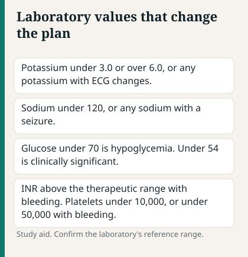
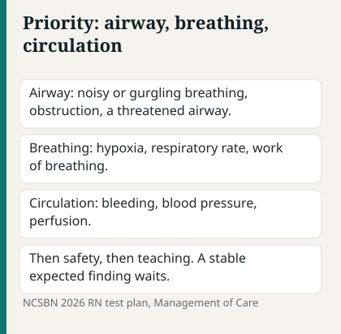
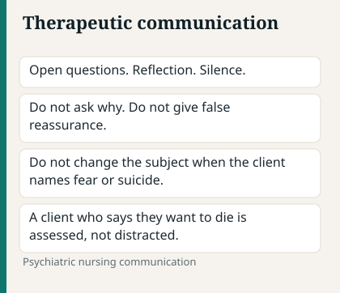
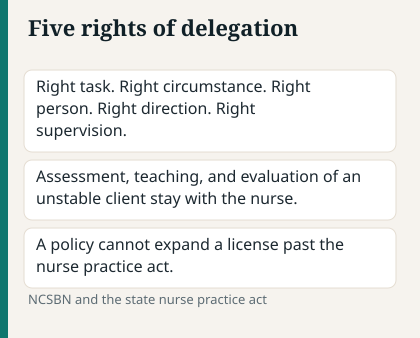
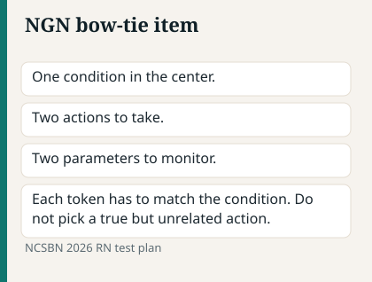

# Chapter 15 — Quick Reference & Final Sprint

> **Study aid only.** Lab ranges vary by laboratory and population. Use as a memory scaffold — confirm with your program’s accepted ranges and current clinical sources.

---

## ABCs + priority order (pocket)

Source: VA/DoD major depressive disorder guideline, 2022.

1. Airway obstruction / compromise
2. Breathing failure / severe distress
3. Circulation — shock, uncontrolled bleed, lethal rhythms
4. Neuro disability / acute change in LOC
5. Safety (falls, suicide means, infection exposure)
6. Pain, education, psychosocial (unless that’s the stem’s true focus and client is stable)

**Tie-breakers:** acute > chronic · unstable > stable · unexpected > expected · actual > risk (when acuity otherwise similar)

---

## Isolation — ultra short

Source: CDC isolation precautions, 2007.

| Type | Think | PPE highlight |
| --- | --- | --- |
| Standard | Everyone | Hand hygiene |
| Contact | C. diff, MRSA* | Gown + gloves; soap & water for C. diff |
| Droplet | Flu, N. meningitidis | Mask |
| Airborne | TB, measles | N95 + airborne room |
| Airborne **+ Contact** | Varicella, disseminated zoster | N95 + airborne room **+ gown and gloves** |

\*Follow current facility/CDC-aligned practice.

---

## Labs — know the danger zone (direction + urgency)

Source: NCSBN RN Test Plan, 2026.

Exact numbers vary. Focus on **which way is dangerous** and **what you do**.

| Lab | Low concern | High concern |
| --- | --- | --- |
| **Na⁺** | Seizures, confusion | Thirst, neuro changes |
| **K⁺** | Dysrhythmia, weakness | Peaked T, emergency risk |
| **Ca²⁺** | Tetany, spasms | Weakness, stones, moans |
| **Mg²⁺** | Dysrhythmia, tetany | Reflexes ↓, RR ↓ if severe |
| **Glucose** | Shake/sweat/confusion/seizure | Dehydration, DKA/HHS risk |
| **Hgb / Hct** | Fatigue, bleed signs, O₂ carry ↓ | Context (e.g., polycythemia) |
| **WBC** | Infection risk (neutropenia) | Infection/inflammation |
| **ANC** | Febrile neutropenia urgency | — |
| **Platelets** | Bleeding risk; **falling count on heparin = HIT** (thrombosis risk — stop heparin) | Thrombocytosis — clot risk in context |
| **INR / aPTT** | Clot risk if too low on therapy | Bleed risk if too high |
| **Creatinine / BUN** | — | Kidney injury / clearance |
| **Troponin** | — | Cardiac injury |
| **Lactate** | — | Perfusion/sepsis concern |
| **BNP** | — | HF strain |
| **Ammonia** | — | Encephalopathy context |
| **Lipase** | — | Pancreatitis context |
| **LFTs** | — | Hepatotoxicity / HELLP context |
| **CK** | — | Rhabdo / statin injury |

**Remember this:** A **trending** change often matters more than one static number.

---

## Therapeutic communication — keep / kill

Source: NCSBN RN Test Plan, 2026.

**Keep:** “Tell me more.” “This is difficult.” “What concerns you most?” reflection, silence, clarification, open-ended.
**Kill:** “Don’t worry.” “Why did you…” “You should…” “Everyone feels that way.” judgment, false reassurance, changing subject, advising abruptly.

---

## Delegation pocket

Source: NCSBN/ANA National Guidelines for Nursing Delegation, 2019.

| Keep with RN | Often LPN/LVN | Often UAP |
| --- | --- | --- |
| Unstable, new admit assess, initial teach, care plan, IVP per policy | Stable predictable, reinforce teach, many meds per scope | ADLs, VS stable, I&O, position |

Five rights: task, circumstance, person, direction, supervision.

---

## Emergency action flashes

Source: AHA/ASA early management of ischemic stroke, 2019.

| Situation | First moves |
| --- | --- |
| Chest pain unstable | Stay, ABCs, ECG/monitor, activate pathway, aspirin/nitro per orders |
| PE suspicion | Stay, O₂, escalate |
| Stroke | NPO, last known well, pathway, glucose |
| Seizure | Protect, time, nothing in mouth |
| Status epilepticus | Help, airway, benzo per protocol |
| Hypoglycemia conscious | 15-15 carb concept |
| Hypoglycemia unconscious | Glucagon / IV dextrose per orders |
| Anaphylaxis | Epinephrine IM, airway |
| Boggy fundus | Massage + help |
| Late decels | Stop oxytocin per protocol, reposition, O₂, notify |
| Mag toxicity | Stop mag, Ca gluconate, airway |
| Hyperkalemia + ECG | Monitor + emergent protocol |
| Compartment | Notify now — pain out of proportion |
| Neutropenic fever | Cultures + prompt Abx pathway |
| Pulseless VT/VF | CPR + defib |
| Asystole/PEA | CPR + reversible causes (not shock) |
| Autonomic dysreflexia | Sit up + find stimulus |
| Transfusion reaction | Stop transfusion, NS per protocol |
| Wound dehiscence/evisceration | Sterile saline moist dressing, don’t push organs back, notify |
| Suspected abuse (child) | Safety + mandated report |

---

## Must-know comparison tables (sprint)

Source: NCSBN RN Test Plan, 2026.

### Left vs right HF

Source: NCSBN RN Test Plan, 2026.

| Left | Right |
| --- | --- |
| Pulmonary crackles, orthopnea | JVD, edema, hepatomegaly |

### DKA vs HHS

Source: NCSBN RN Test Plan, 2026.

| DKA | HHS |
| --- | --- |
| Ketones + acidosis, often younger T1D | Profound hyperosmolar dehydration, often older T2D |

### Croup vs epiglottitis

Source: NCSBN RN Test Plan, 2026.

| Croup | Epiglottitis |
| --- | --- |
| Barky cough | Drooling, toxic, no cough — don’t blade throat |

### Previa vs abruption

Source: NCSBN RN Test Plan, 2026.

| Previa | Abruption |
| --- | --- |
| Painless bleed; no vaginal exam | Painful, board-like uterus |

### Early vs late ICP

Source: NCSBN RN Test Plan, 2026.

| Early | Late |
| --- | --- |
| LOC change | Cushing’s triad, fixed pupils |

### Contact vs droplet vs airborne (memory)

Source: NCSBN RN Test Plan, 2026.

Soap/water for C. diff · Mask for droplet · N95+room for airborne

---

## Antidote & high-alert flash

Source: ADA Standards of Care in Diabetes, 2026.

| Problem | Antidote / action pattern |
| --- | --- |
| Opioid OD | Naloxone |
| Mag toxicity | Calcium gluconate |
| Warfarin bleed | Vitamin K / PCC |
| Heparin | Protamine |
| Acetaminophen OD | NAC |
| Hypoglycemia | Glucose / glucagon |
| Malignant hyperthermia | Dantrolene |
| Extrapyramidal acute dystonia | Benztropine / diphenhydramine |
| Dig toxicity severe | Digoxin immune Fab |
| Benzodiazepine (selected) | Flumazenil — cautious |

**High-alert:** insulin, anticoags, opioids, chemo, concentrated electrolytes — double-check.

---

## Fetal monitoring & maternity flash

Source: NCSBN RN Test Plan, 2026.

| Pattern | Action |
| --- | --- |
| Late decels | Stop Pitocin per protocol, left lateral, O₂, notify |
| Variables | Reposition ± amnioinfusion as ordered |
| Boggy fundus | Massage, empty bladder, uterotonics |
| Cord prolapse | Relieve pressure, knee-chest, to OR |

---

## 7-day final sprint

Source: NCSBN RN Test Plan, 2026.

| Day | Do this |
| --- | --- |
| −7 | Full sim + error log |
| −6 | Pharm + calc + high-alert |
| −5 | Med-surg emergencies + ABCs drills |
| −4 | Maternity/peds/psych mixed |
| −3 | NGN case studies × 3 |
| −2 | Weakest topics only + this labs sheet |
| −1 | Light review + logistics + sleep |

---

## Error-log mini template

Source: NCSBN/ANA National Guidelines for Nursing Delegation, 2019.

1. Topic: __________
2. Miss type: cue / priority / content / misread / calc
3. Correct rule (1 sentence): __________
4. Drill tomorrow: 10 similar Qs
5. CJMM step missed (recognize / analyze / prioritize / generate / act / evaluate): __________

---

## NGN bow-tie mental template (study aid)

Source: NCSBN/ANA National Guidelines for Nursing Delegation, 2019.

**Center (condition):** What is the priority problem?
**Left (actions):** What do you do first / next?
**Right (monitor):** What parameters show improvement or deterioration?

Practice this aloud on every case study — even when the item format differs.

---

## Remember this (sprint)

Source: NCSBN RN Test Plan, 2026.

- Process > panic on every item.
- Safety → ABC → Maslow → nursing process.
- Review lucky-right answers too.
- Sleep is a study strategy.
- Official rules live in NCSBN documents — this sheet is a study aid.
