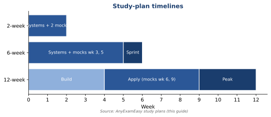

# Free PANCE Study Guide (2026): Blueprint-Weighted Plans, Frameworks & High-Yield Topic Index

**Aligned to the official NCCPA blueprint. Weighted for study planning.**

This is **AnyExamEasy's free PANCE Study Guide**.

It gives you a plan, the 3 question types PANCE asks most, and a topic map where **study time matches exam points**.

[**Try PANCE practice free →**](/signup?plan=trial&interval=monthly&tier=pro&exam=pance)

> **Study aid only.** This guide helps you prepare for an exam. It is **not** medical advice. It does not replace your PA program, your preceptors, or official **NCCPA** documents. A rule that names a source was checked against that page in October 2026. Confirm the current official page before you use a rule in clinic.

> **MUST KNOW**
> - **300 questions**, in **5 blocks of 60**
> - **60 minutes per block** (about 1 minute per question)
> - Scored **200–800**. **You pass at 350.**

---

## What's inside

- **3 study plans:** 2, 6, and 12 weeks
- **How PANCE works:** format, timing, scoring, retake rules
- **The official blueprint:** all 15 content areas and 8 task areas
- **3 core frameworks:** diagnosis, next step, first-line treatment
- **Topic index**, ordered by exam weight
- **System chapters** with a Top 5, look-alike tables, and the rules that name a source
- **Diagrams** for blood pressure, exam day, and selected workups
- **Traps + error log**, exam day, a 7-day sprint
- **Quick refs, FAQ,** and a **sources appendix**

**Path note:** This guide is for **PANCE**, the first certification exam after PA school. **PANRE** and **PANRE-LA** are NCCPA's *recertification* exams for PAs who are already certified. See the FAQ.

---

## Who this is for

- PA students in their last semester
- New grads inside their testing window
- Repeat takers who want a sharper system
- Anyone who wants **one free guide + one practice tool**, not a stack of pricey products

## Why this guide is different

- **Weighted to points.** Big systems get big sections.

AnyExamEasy is **one study system for six boards** (NCLEX, USMLE, NAPLEX, PANCE, AANP FNP, NPTE-PT).

---

## How to use this guide

1. **Pick a plan** (2, 6, or 12 weeks).
2. **Read "How PANCE works"** once.
3. **Learn the 3 frameworks.** Use them on every question.
4. **Work the topic index from the top.** It's sorted by points.
5. **Use each checklist as a self-test.** Can't explain a line? Drill it.
6. **Practice every day.** Log every miss.
7. **Finish with the sprint** and exam-day list.

**Pro tip:** Read one checklist → do 20–40 matching questions → write 3 lines in your error log.

---

## How to use it with AnyExamEasy

| Piece | What it does |
| --- | --- |
| **This guide** | Plan, frameworks, topic map, traps |
| **PANCE Qbank** | Exam-style questions, rationales, Blueprint Roadmaps, full mocks |

**Daily loop:** checklist → 60-question timed set → review every rationale → update error log.

**Start free** at [anyexameasy.com](https://anyexameasy.com). $27.99/mo after trial; trial terms on site.

---

## Pick your plan

| Plan | Best if you… | Questions/day |
| --- | --- | --- |
| **2 weeks** | Just finished rotations; content is fresh | 120–180 |
| **6 weeks** | Have a solid base | 60–120 |
| **12 weeks** | Are retaking, working, or rusty | 40–90 (build up) |

**Key rule:** Give each system time that matches its blueprint %.

**Cardio + Pulm + GI + MSK = 36% of the exam.** Start there.

---

## Study plans

*Figure: Study-plan timelines.*

### 2-week plan

| Day | Focus | Questions |
| --- | --- | --- |
| 1 | Format + frameworks + baseline block | 60 timed |
| 2 | Cardiovascular (11%) | 150 |
| 3 | Pulmonary (9%) | 150 |
| 4 | GI (8%) + MSK (8%) | 150 |
| 5 | Infectious (7%) + Neuro (7%) | 150 |
| 6 | Psych (7%) + Reproductive (7%) | 150 |
| 7 | **Full mock (5 × 60)** | 300 |
| 8 | Endocrine (6%) + EENT (6%) | 150 |
| 9 | Heme (5%) + Renal (5%) | 150 |
| 10 | Derm + GU + Professional Practice | 150 |
| 11 | Your 3 weakest systems | 120 |
| 12 | **Second full mock** | 300 |
| 13 | Quick refs only | 60 |
| 14 | Rest. Sleep. | — |

### 6-week plan

| Week | Systems | Extra |
| --- | --- | --- |
| 1 | Cardio, Pulm | Baseline block on day 1 |
| 2 | GI, MSK, Renal | Weekly error-log review |
| 3 | ID, Neuro, Psych | **Mock 1** |
| 4 | Reproductive, Endocrine, EENT | Tag peds + surgery items |
| 5 | Heme, Derm, GU, Professional Practice | **Mock 2** |
| 6 | Weak areas + sprint | **Mock 3** on day −7 |

**Sample day:** 30 min checklist → 60-question block → 60–90 min review → 3 log lines.

### 12-week plan

- **Weeks 1–4 (Build):** one system every 2–3 days, in weight order. 40–60 questions a day.
- **Weeks 5–9 (Apply):** mixed timed blocks. 60–90 a day. Mocks at weeks 6 and 9.
- **Weeks 10–12 (Peak):** 90+ a day. One mock a week. Then the sprint.

**Working full-time?** Protect one block each weekday. Do a full mock on weekends during the Peak phase.

> **Ready to practice?** Explore PANCE questions on [AnyExamEasy](/pance). Start free; $27.99/mo after trial (trial terms on site).

---
