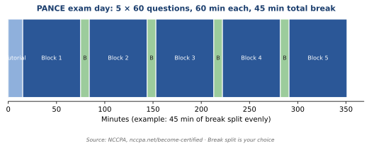
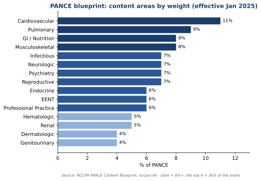
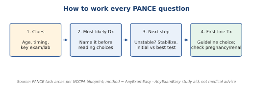

# How PANCE works

### The basics

| Fact | Detail |
| --- | --- |
| Where | Pearson VUE test centers |
| Questions | **300** multiple choice (5 blocks × 60) |
| Time | **60 min per block** |
| Breaks | **45 min total**, you manage it |
| Tutorial | 15 min |
| Total visit | About 6 hours |

### Scoring and rules

| Fact | Detail |
| --- | --- |
| Score scale | **200–800** |
| Passing score | **350** |
| Unscored items | Some pretest items. You can't tell which. |
| Who can take it | Grads of ARC-PA–accredited programs |
| Attempt limit | **6 tries within 6 years** |
| Retake spacing | Once per 90 days; max 3 per year |
| Fee | **$550** application payment ([NCCPA Become Certified](https://www.nccpa.net/become-certified/)) |

*Figure: Exam-day timeline. NCCPA.*

**Pacing:** 60 questions in 60 minutes. **Train with timed 60-question blocks from week 1.**

### The official blueprint (effective January 2025)

**Content areas (organ systems)**

| Area | % of exam |
| --- | --- |
| Cardiovascular | **11%** |
| Pulmonary | **9%** |
| GI / Nutrition | **8%** |
| Musculoskeletal | **8%** |
| Infectious Diseases | 7% |
| Neurologic | 7% |
| Psychiatry / Behavioral | 7% |
| Reproductive | 7% |
| Endocrine | 6% |
| Eyes, Ears, Nose, Throat (EENT) | 6% |
| Professional Practice | 6% |
| Hematologic | 5% |
| Renal | 5% |
| Dermatologic | 4% |
| Genitourinary (GU) | 4% |

**Task areas (what you're asked to do)**

| Task | % of exam |
| --- | --- |
| **Most likely diagnosis** | **18%** |
| History and physical exam | 16% |
| Clinical intervention | 16% |
| Pharmaceutical therapeutics (drugs) | 15% |
| Health maintenance and prevention | 11% |
| Diagnostic and lab studies | 10% |
| Applying foundational science | 8% |
| Professional practice | 6% |

**Also from NCCPA:**

- Medical content is **94%** of the exam.
- **8–10%** of questions cover general surgery topics.
- **12–15%** focus on children (pediatrics).

**What this means for you:** Treatment-type tasks (drugs + intervention + prevention) are **42%**. Diagnosis + history and physical are **34%**. **Know what it is and what to do next.**

*Figure: PANCE content weights. NCCPA blueprint, effective January 2025.*

**Official source:** [NCCPA PANCE Blueprint](https://www.nccpa.net/become-certified/pance-blueprint/). This guide helps you prepare. It does not replace NCCPA.

> **Want practice that feels real?** Try free PANCE questions on [AnyExamEasy](/signup?plan=trial&interval=monthly&tier=pro&exam=pance).

---

## The 3 question types PANCE asks most

Every question is a short patient story. Then it asks one of three things.

### 1. "What is the most likely diagnosis?"

- Find the **2–3 key clues** (age, timing, exam finding, lab).
- Name your top guess **before** reading the choices.
- **Pick the common, classic answer.** PANCE rarely rewards rare diseases.

### 2. "What is the next best step?"

- **Unstable patient? Stabilize first.** Airway, breathing, circulation.
- Read the word: **"initial"** test ≠ **"best/confirmatory"** test.
- Choose the **least invasive test that answers the question.**

### 3. "What is the first-line treatment?"

- Pick the **guideline** first-line choice.
- Then check the stem for **traps**: pregnancy, kidney function, allergy, age.

*Figure: The 4-step question method.*

### Quick elimination tips

- Two nearly identical choices? One is often right.
- "Most appropriate" means **the standard**, not "something you could do."
- Child in the stem? Re-check age-based rules.

> **Important to remember:** Diagnose → stabilize → test → treat → prevent. **Ask which step the question is on.**

---

## Topic index (sorted by points)

Abbreviations are spelled out in each system section.

| System | % | Must-cover topics |
| --- | --- | --- |
| Cardiovascular | 11 | Hypertension, ACS, heart failure, AF, lipids, murmurs, dissection, pericarditis, DVT |
| Pulmonary | 9 | Asthma, COPD, pneumonia, PE, TB, lung cancer screening, pneumothorax, croup/bronchiolitis |
| GI / Nutrition | 8 | Pancreatitis, gallbladder disease, appendicitis, GI bleed, H. pylori, hepatitis B, CRC screening |
| MSK | 8 | Fractures, Ottawa rules, gout, RA vs OA, osteoporosis, low back red flags, peds hip |
| Infectious | 7 | STIs, HIV, sepsis, meningitis, Lyme, latent TB, cellulitis |
| Neurologic | 7 | Stroke, SAH, migraine, seizures, MS, myasthenia, Guillain-Barré |
| Psychiatry | 7 | Depression, anxiety, bipolar, psychosis, substance use, drug side effects |
| Reproductive | 7 | Preeclampsia, ectopic, bleeding in pregnancy, cervical and breast screening |
| Endocrine | 6 | Diabetes, DKA, thyroid, adrenal |
| EENT | 6 | Strep throat, otitis media, red eye emergencies |
| Professional Practice | 6 | Consent, capacity, confidentiality, ethics, errors |
| Hematologic | 5 | Anemias, clotting disorders, leukemia/lymphoma |
| Renal | 5 | AKI, CKD, electrolytes |
| Dermatologic | 4 | Melanoma, cellulitis vs abscess, rashes |
| GU | 4 | UTI, BPH, prostate screening, scrotal pain |

---
