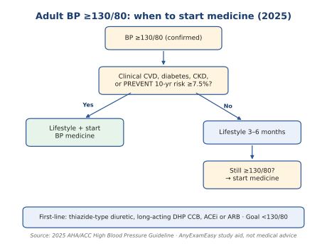
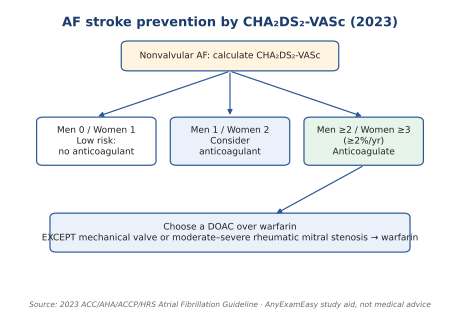
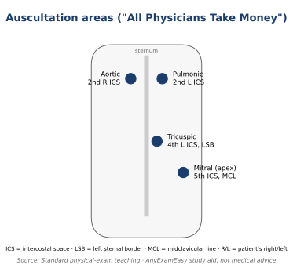
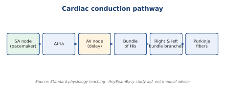
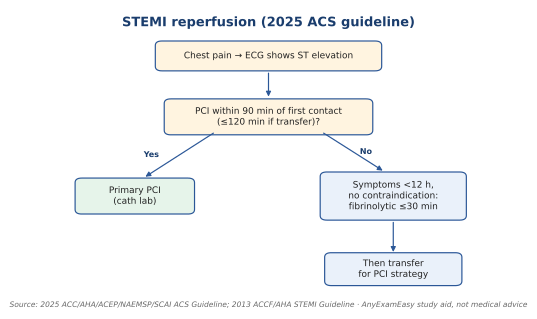

## System checklists

**How to read this section**

- **"Classic clue"** columns = standard textbook teaching points. They help you *recognize* a disease.

---

# Cardiovascular (11%): your biggest block

**Top 5 high-yield**

1. Blood pressure stages and when to start drugs
2. STEMI timing: cath lab vs clot-buster
3. Heart failure "four pillars"
4. AF: when to start a blood thinner
5. Statin groups

**Abbreviations:** BP = blood pressure. CVD = cardiovascular disease. CKD = chronic kidney disease. ACS = acute coronary syndrome. STEMI = ST-elevation heart attack. PCI = cath-lab stenting. HFrEF = heart failure with reduced ejection fraction. AF = atrial fibrillation. DOAC = direct oral anticoagulant. LDL = "bad" cholesterol. ECG = electrocardiogram. ARNI = angiotensin receptor–neprilysin inhibitor. MRA = mineralocorticoid receptor antagonist (e.g., spironolactone). SGLT2 inhibitor = a diabetes-drug class with heart and kidney benefit. CHA₂DS₂-VASc = AF stroke-risk score.

**Blood pressure stages**

| Stage | Top number | Bottom number |
| --- | --- | --- |
| Normal | <120 | and <80 |
| Elevated | 120–129 | and <80 |
| Stage 1 | 130–139 | or 80–89 |
| Stage 2 | ≥140 | or ≥90 |

Stages use the systolic **or** diastolic cutoff. The treatment goal in the checklist is **under 130/80 mm Hg**. ([2025 AHA/ACC high blood pressure guideline](https://www.ahajournals.org/doi/10.1161/CIR.0000000000001356))

*Figure: When to start BP medicine. 2025 AHA/ACC.*

**Checklist**

- [ ] **General BP goal: <130/80 mm Hg.** ([2025 AHA/ACC high blood pressure guideline](https://www.ahajournals.org/doi/10.1161/CIR.0000000000001356))
- [ ] **Start BP medicine at an average of 130/80 mm Hg or higher** when the patient has clinical cardiovascular disease, diabetes, CKD, or a PREVENT 10-year risk of 7.5% or higher. ([2025 AHA/ACC high blood pressure guideline](https://www.ahajournals.org/doi/10.1161/CIR.0000000000001356))
- [ ] **Lower risk (PREVENT under 7.5%, and no clinical cardiovascular disease, diabetes, or CKD):** try lifestyle changes for 3 to 6 months. Start medicine if BP stays 130/80 mm Hg or higher. ([2025 AHA/ACC high blood pressure guideline](https://www.ahajournals.org/doi/10.1161/CIR.0000000000001356))
- [ ] **First-line BP drug classes:** thiazide-type diuretic, long-acting dihydropyridine calcium channel blocker, ACE inhibitor, or ARB. ([2025 AHA/ACC high blood pressure guideline](https://www.ahajournals.org/doi/10.1161/CIR.0000000000001356))

*Figure: AF stroke prevention. 2023 ACC/AHA/ACCP/HRS.*

*Figure: Where to listen for murmurs.*

*Figure: Cardiac conduction system.*

**Look-alike chest pain**

| Disease | Classic clue (teaching point) | First test |
| --- | --- | --- |
| Heart attack (ACS) | Pressure-like pain, risk factors | ECG |
| Pericarditis | Sharp pain, better leaning forward; diffuse ST elevation | ECG |
| Aortic dissection | Tearing pain to the back; arm BP difference | Imaging of aorta |
| Pulmonary embolism | Sudden shortness of breath, fast heart rate | See PE algorithm |

**Algorithm: STEMI**

*Figure: STEMI reperfusion. 2025 ACS guideline.*

> **Important to remember**
> - **ECG first** for chest pain.
> - **Trap:** choosing a clot-buster when the stem says PCI is available in time.
> - **The 2025 BP guideline** uses the PREVENT risk tool and a 7.5% cut-off.

---
