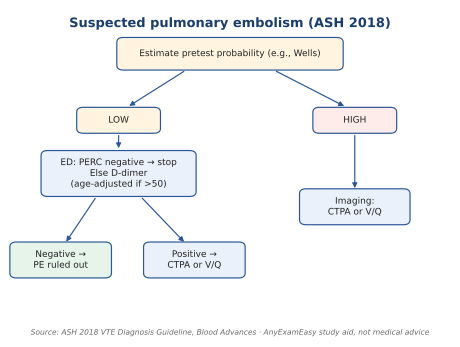
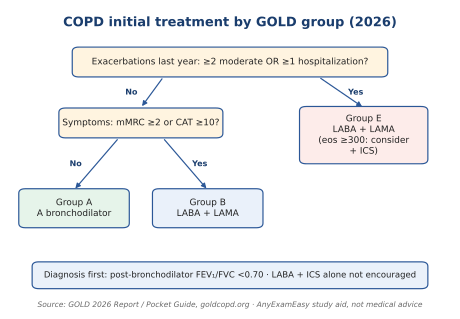
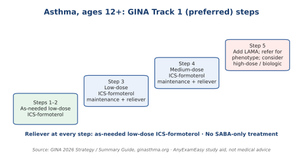

# Pulmonary (9%)

**Top 5 high-yield**

1. Asthma: no "rescue inhaler only" treatment
2. COPD: diagnosis and first inhalers
3. Outpatient pneumonia antibiotics
4. PE workup
5. Lung cancer screening

**Abbreviations:** SABA = short-acting rescue inhaler (e.g., albuterol). ICS = inhaled steroid. LABA / LAMA = long-acting bronchodilators. FEV₁/FVC = breathing-test ratio. CAP = community-acquired pneumonia. PE = pulmonary embolism. CTPA = CT pulmonary angiogram. LDCT = low-dose CT. PERC = PE rule-out criteria. V/Q = ventilation-perfusion scan.

**Algorithm: suspected PE**

*Figure: Suspected PE. ASH 2018.*

*Figure: COPD groups. GOLD 2026.*

*Figure: Asthma steps. GINA 2026.*

**Look-alike: asthma vs COPD**

| Feature | Asthma | COPD |
| --- | --- | --- |
| Typical patient | Younger, allergies | Older, smoking history |
| Breathing test | Often reversible | Often not fully reversible |
| Starting treatment | See the GINA figure | See the GOLD figure |

> **Important to remember**
> - **Trap:** D-dimer when probability is high. Go to imaging.

---

<!-- premium -->

## Pulmonary in depth

Pulmonary disease is 9% of the exam. GINA 2026 and GOLD 2026 are the two regimens to know exactly.

**Asthma**

GINA 2026 Track 1, for ages 12 and older, does not use a short-acting beta-agonist as the only reliever. Steps 1 and 2 are as-needed low-dose inhaled corticosteroid-formoterol. Step 3 is low-dose maintenance and reliever therapy with the same combination. Step 4 raises the maintenance dose. Step 5 adds a long-acting muscarinic antagonist and refers. A patient who is still on albuterol alone is not on the preferred track. A severe exacerbation is marked by inability to speak in sentences, a silent chest, hypoxia, or a peak flow under about half of predicted. Those patients need oxygen, repeated short-acting bronchodilator, and a systemic corticosteroid. Magnesium is for life-threatening attacks that are not responding.

**COPD**

Diagnosis requires symptoms plus spirometry: a post-bronchodilator FEV1/FVC under 0.7. GOLD 2026 groups the initial inhaler by symptoms and exacerbations. Group A (few symptoms, few exacerbations) starts with a bronchodilator. Group B (mMRC 2 or higher, or CAT 10 or higher) starts with a LABA plus a LAMA. Group E (two or more moderate exacerbations, or one hospitalization) starts with a LABA plus a LAMA, and an inhaled corticosteroid is considered when the blood eosinophil count is 300 cells/µL or higher. Smoking cessation is the intervention that changes the course of the disease. Offer pharmacotherapy with behavioral support (USPSTF 2021 tobacco cessation recommendation: varenicline, nicotine replacement, or bupropion). In a patient at risk of hypercapnia, target oxygen saturation about 88 to 92%. Extra oxygen can worsen ventilation-perfusion matching. Do not explain that fall only as "loss of hypoxic drive."

An exacerbation with increased dyspnea, sputum volume, and sputum purulence is treated with a short corticosteroid course (prednisone 40 mg daily for 5 days is the common regimen) and an antibiotic when purulence is part of the picture.

**Embolism, effusion, and infection**

Estimate pretest probability before you order a D-dimer. Low probability in the emergency department can use the PERC rule. Otherwise a D-dimer is used when probability is low or intermediate. A negative result excludes pulmonary embolism in that setting. High probability, or a positive D-dimer, goes to CT pulmonary angiography, or to a ventilation-perfusion scan when contrast is unsafe. Shock from embolism is a reperfusion decision, not a D-dimer. The ASH 2018 venous thromboembolism guideline remains the cited algorithm for this sequence.

Light criteria separate a pleural exudate from a transudate. The fluid is an exudate if the protein ratio (fluid/serum) is greater than 0.5, the LDH ratio is greater than 0.6, or the fluid LDH is greater than two-thirds of the upper limit of normal serum LDH. One positive criterion is enough. Transudates are heart failure, cirrhosis, and nephrotic syndrome. Exudates are infection, cancer, and pulmonary embolism.

Outpatient community-acquired pneumonia in a healthy adult is treated with amoxicillin, doxycycline, or a macrolide only where pneumococcal resistance is low (IDSA/ATS). Comorbidity or recent antibiotics changes the regimen, often to a beta-lactam plus a macrolide, or to respiratory fluoroquinolone monotherapy. Do not use a fluoroquinolone as the reflex choice for a healthy adult.

**Other high-yield patterns**

A tall young smoker with sudden pleuritic pain and reduced breath sounds has a pneumothorax. Tension pneumothorax (hypotension, tracheal deviation, distended neck veins) is decompressed. It is not observed. Bilateral hilar lymphadenopathy with erythema nodosum in a young adult is sarcoidosis until biopsy says otherwise. Progressive dyspnea, dry cough, clubbing, and basal crackles in an older adult are the pattern of idiopathic pulmonary fibrosis. Refer. Do not start a long corticosteroid course as if it were asthma. Snoring, witnessed apneas, and daytime sleepiness are obstructive sleep apnea. Polysomnography or a home sleep test confirms it. Positive airway pressure is first-line treatment. Active tuberculosis is treated with rifampin, isoniazid, pyrazinamide, and ethambutol. Latent tuberculosis is a shorter rifamycin regimen when drug interactions allow. Rifampin induces many enzymes and will lower the level of a DOAC.

Lung cancer screening, USPSTF 2021: annual low-dose CT for adults 50 to 80 who have a 20 pack-year history and who currently smoke or quit within the past 15 years. Stop when the patient has not smoked for 15 years, or when a condition limits life expectancy or the ability to have curative treatment. A screen-detected nodule is followed with the radiology protocol. It is not ignored because the patient feels well.

> **Important to remember**
> - No short-acting beta-agonist as the only asthma treatment (GINA 2026).
> - Group E COPD starts with LABA plus LAMA (GOLD 2026).
> - High-probability pulmonary embolism goes to imaging, not a D-dimer.

<!-- /premium -->

