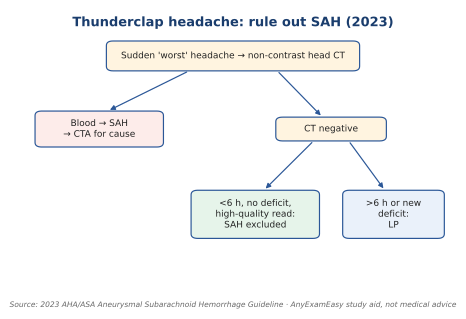

# Neurologic (7%)

**Top 5 high-yield**

1. Acute stroke: CT first, clot-buster window
2. Thunderclap headache workup
3. Migraine first-line treatment
4. Guillain-Barré vs myasthenia
5. Seizure first steps

**Abbreviations:** CT = CT scan. LP = lumbar puncture. SAH = subarachnoid hemorrhage. tPA = alteplase. TNK = tenecteplase. CTA = CT angiogram.

**Checklist**

- [ ] **Stroke:** non-contrast head CT first to rule out bleeding. [C36]
- [ ] **Clot-buster window:** within **4.5 hours** of last known well. [C36]
- [ ] **Clot-buster options:** alteplase **or** tenecteplase. [C36]
- [ ] **Don't delay the clot-buster** to wait for extra imaging (CTA/perfusion). [C36]
- [ ] **Sudden "worst headache":** non-contrast CT. [C37]
- [ ] **Seen >6 hours after onset (or new deficit) and CT negative:** do an LP. [C37]
- [ ] **Seen <6 hours, no deficit:** a high-quality CT read by a neuroradiologist can rule out SAH. [C37]
- [ ] **Migraine attack:** NSAIDs for mild–moderate; **triptans** for moderate–severe. [C38]

**Algorithm: thunderclap headache [C37]**

*Figure: Thunderclap headache. 2023 AHA/ASA aSAH guideline.*

*Text version:* CT first. Negative CT: <6 h with a high-quality read excludes SAH; >6 h or new deficit → LP.

**Look-alike: weakness (classic teaching points)**

| Disease | Classic clue | Pattern |
| --- | --- | --- |
| Guillain-Barré | After an infection; reflexes gone | Rising weakness |
| Myasthenia gravis | Droopy eyelids, double vision | Worse at end of day |
| Multiple sclerosis | Vision loss, numbness, young adult | Episodes over time |

> **Important to remember:** **CT before any clot-buster.** Always.

---
