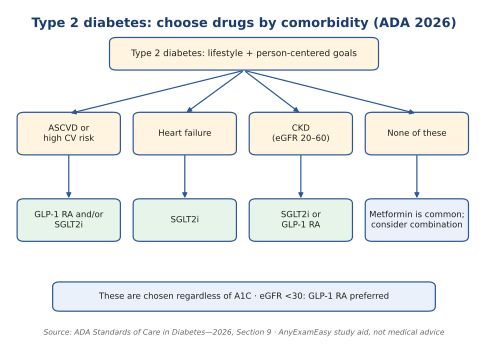

# Endocrine (6%)

**Top 5 high-yield**

1. Diabetes diagnosis numbers
2. Type 2 diabetes drug choice by comorbidity
3. DKA criteria and potassium rule
4. Diabetes screening
5. Hypothyroidism treatment

**Abbreviations:** A1C = 3-month sugar average. FPG = fasting glucose. OGTT = glucose tolerance test. GLP-1 RA = GLP-1 receptor agonist. SGLT2i = SGLT2 inhibitor. DKA = diabetic ketoacidosis. TSH = thyroid-stimulating hormone.

*Figure: Type 2 diabetes drug choice. ADA 2026.*

---

<!-- premium -->

## Endocrine in depth

Endocrine disease is 6% of the exam. The numbers are the question.

**Diabetes**

The ADA Standards of Care in Diabetes (2026) diagnose diabetes with any one of these, confirmed unless the patient is symptomatic: A1C 6.5% or higher, fasting plasma glucose 126 mg/dL or higher, 2-hour glucose 200 mg/dL or higher on a 75 g tolerance test, or a random glucose 200 mg/dL or higher with classic symptoms. Prediabetes is an A1C of 5.7% to 6.4%. The USPSTF 2021 recommendation screens adults 35 to 70 who have overweight or obesity.

Drug choice follows comorbidity, not a single sequence for every patient. Established atherosclerotic disease: a GLP-1 receptor agonist or an SGLT2 inhibitor with proven benefit. Heart failure: an SGLT2 inhibitor. Chronic kidney disease: an SGLT2 inhibitor, or a GLP-1 receptor agonist when the SGLT2 inhibitor is not appropriate. When none of those are present, metformin remains a common foundation, and combination therapy is used to reach the A1C goal. The goal is individualized. A healthy younger adult is often treated toward an A1C under 7%. A frail older adult with falls is not chased to a normal A1C. Hypoglycemia is a glucose under 70 mg/dL. The patient who is awake takes 15 g of carbohydrate and rechecks in 15 minutes. The patient who cannot swallow gets glucagon. Insulin-treated patients need that plan taught before they leave.

Diabetic ketoacidosis is hyperglycemia, an anion-gap acidosis, and ketones. Start isotonic fluid. If the potassium is under 3.3 mEq/L, replace potassium before insulin. Insulin will drive potassium into cells and can stop the heart. Hourly glucose and electrolytes follow. Hyperosmolar hyperglycemic syndrome is a glucose often near 600 mg/dL or higher, high osmolality, little ketoacidosis, and profound dehydration, usually in an older adult. Fluid first. Search for the precipitant.

**Thyroid, adrenal, calcium, and pituitary**

Primary hypothyroidism is a high TSH and a low free T4. Levothyroxine is taken on an empty stomach. Recheck the TSH in about 6 weeks. Start at a lower dose in an older adult and in coronary disease. The ATA hypothyroidism guideline (2014) remains the ATA document for this replacement plan. Biotin can make a free T4 look high and a TSH look low. A thyroid nodule gets a TSH first. A low TSH (a hot nodule) goes to a radionuclide scan. A normal or high TSH goes to ultrasound and, when the sonographic pattern warrants it, fine-needle aspiration. Do not scan every nodule and do not biopsy a hot nodule as if it were cancer.

Thyroid storm is fever, marked tachycardia, and agitation in a patient with Graves disease or another thyrotoxicosis. Treat with a beta-blocker, a thionamide, iodine after the thionamide, and a corticosteroid, in a monitored setting. Do not give iodine first. It can fuel hormone synthesis if synthesis has not been blocked.

Primary adrenal insufficiency is hypotension, hyperkalemia, and hyperpigmentation. Cosyntropin stimulation testing confirms it when the patient is stable. Stress-dose steroids are given when the patient is in crisis. Do not wait for the test result to treat shock. Primary aldosteronism is screened in resistant hypertension, hypertension with hypokalemia, and an adrenal incidentaloma, with the plasma aldosterone-to-renin ratio. Pheochromocytoma is screened with plasma or urine metanephrines before a biopsy of an adrenal mass that could be a pheo.

Hypercalcemia with a high PTH is primary hyperparathyroidism. Surgery is indicated for a calcium well above normal, osteoporosis, kidney stones, reduced kidney function, or age under 50, using the criteria in the endocrine surgery guidelines. Familial hypocalciuric hypercalcemia has a low urine calcium and is not a parathyroidectomy. A glucose of 900 with no significant ketosis was covered above. A high prolactin with galactorrhea is a prolactinoma until a drug cause (an antipsychotic) and hypothyroidism are excluded. A dopamine agonist is first-line medical treatment. Chronic SIADH that needs a drug is often treated with a vaptan or with fluid restriction first, depending on the sodium and the setting. Do not fluid-restrict a hypovolemic patient and call it SIADH.

Polyuria and polydipsia with a normal glucose is diabetes insipidus or primary polydipsia. Urine that stays dilute while the sodium is high-normal is diabetes insipidus. Desmopressin concentrates the urine in central disease and does not in nephrogenic disease. Do not start a water-deprivation test if the patient is already hypernatremic with dilute urine.

> **Important to remember**
> - Potassium before insulin when the potassium is under 3.3 mEq/L.
> - SGLT2 inhibitor for heart failure or albuminuric kidney disease, regardless of the need for more glucose lowering (ADA 2026).
> - TSH before any scan or biopsy plan for a thyroid nodule.

<!-- /premium -->

