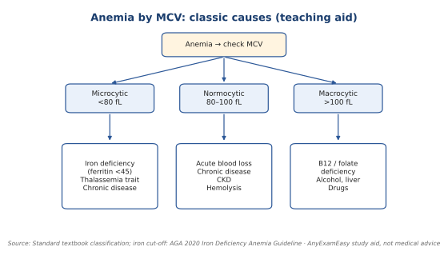

# Hematologic (5%)

**Top 5 high-yield**

1. Iron deficiency diagnosis
2. Microcytic anemia look-alikes
3. Platelet disorders
4. Clotting tests
5. Leukemia/lymphoma clues

**Abbreviations:** MCV = mean corpuscular volume (average red-cell size).

*Figure: Anemia by red-cell size. Teaching aid for recognition, not a ferritin cutoff.*

**Look-alike: small red cells (microcytic) (classic teaching points)**

| Disease | Ferritin | Key clue |
| --- | --- | --- |
| Iron deficiency | Low | Blood loss, heavy periods |
| Thalassemia trait | Normal | Family history, mild anemia |
| Anemia of chronic disease | Normal/high | Chronic illness |

> **Important to remember:** **Iron deficiency in an older adult → look for GI blood loss.**

---
