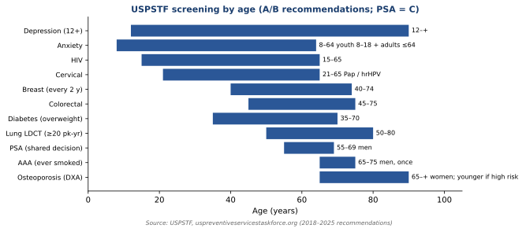

# Quick refs

**Screening (USPSTF)**

*Figure: Screening ages. The table lists the ages checked against the current USPSTF pages.*

| Test | Who | Source |
| --- | --- | --- |
| Colorectal | 45–75 | [USPSTF](https://www.uspreventiveservicestaskforce.org/uspstf/recommendation/colorectal-cancer-screening) |
| Breast | Every 2 years, 40–74 | [USPSTF](https://www.uspreventiveservicestaskforce.org/uspstf/recommendation/breast-cancer-screening) |
| PSA | Men 55–69: individual decision. Do not screen at 70 or older. | [USPSTF](https://www.uspreventiveservicestaskforce.org/uspstf/recommendation/prostate-cancer-screening) |

**"First test" pairs**

| Situation | First step |
| --- | --- |
| Chest pain | ECG |

<!-- premium -->

## First step, with the source

| Situation | First step | Source |
| --- | --- | --- |
| Chest pain that could be ischemic | 12-lead ECG | 2025 ACC/AHA acute coronary syndromes guideline |
| Suspected stroke, last known well within the treatment window | Noncontrast CT of the head, and glucose | AHA/ASA early management of ischemic stroke, 2019 |
| Sepsis with hypotension | Blood cultures, then an antibiotic, and intravenous fluid | Surviving Sepsis Campaign, 2021 |
| Streptococcal pharyngitis, intermediate Centor score | Rapid antigen test, then penicillin or amoxicillin if positive | IDSA streptococcal pharyngitis guideline, 2012 |
| Acute otitis media when an antibiotic is indicated | High-dose amoxicillin | AAP acute otitis media guideline, 2013 |
| Acute kidney injury | Creatinine and urine output, and stop the nephrotoxin | KDIGO acute kidney injury guidance, 2024 |
| Stage 2 hypertension in an adult who is not pregnant | Two first-line drugs from different classes | 2025 AHA/ACC high blood pressure guideline |
| Pregnancy with hypertension | Do not start an ACE inhibitor or an ARB | ACOG Practice Bulletin 222, 2020 |

These are study prompts. The dose on a real patient comes from the current label and the full guideline, not from this table.

<!-- /premium -->

---
