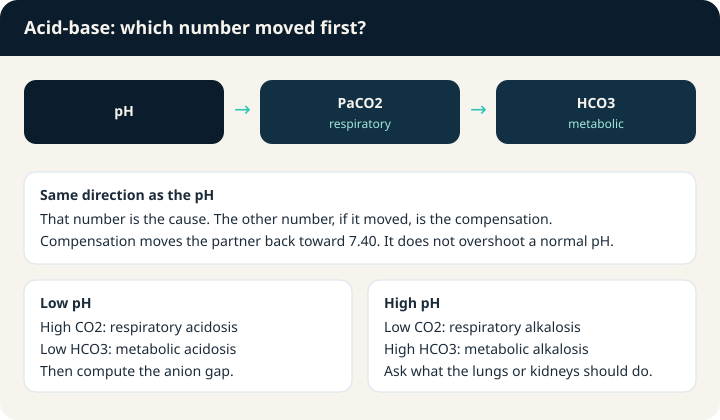

# Pulmonary and renal mechanisms

## Framework

These two systems are one chapter because Step 1 puts them in one large outline range, and because both are about a gradient: air versus blood, and filter versus tubule.

**Gas exchange**

| Problem | A-a gradient | The idea |
| --- | --- | --- |
| High altitude or hypoventilation | Normal | The lung is working. There is less oxygen in, or less ventilation. |
| V/Q mismatch, shunt, diffusion block | High | Oxygen is not reaching blood that is flowing. |
| Shunt | High, and oxygen does not fully fix it | Blood never sees alveoli. |

Airway obstruction (asthma, COPD physiology) traps air. FEV1 falls more than FVC, so the ratio falls. Restriction (fibrosis, weak muscles, a stiff chest) shrinks the volumes. The ratio stays normal or high.

**Nephron, by job**

| Segment | Job | A drug or a disease |
| --- | --- | --- |
| Proximal tubule | Most reabsorption, bicarbonate, glucose | Carbonic anhydrase inhibitors. Fanconi wastes everything. |
| Thin limb | Concentrates the medulla | Loop diuretics kill the gradient from the thick limb. |
| Thick ascending limb | NKCC2 pulls salt out. Waterproof. | Loop diuretics. Bartter looks like a loop diuretic. |
| Distal convoluted | NCC | Thiazides. Gitelman looks like a thiazide. |
| Collecting duct | Aldosterone, ADH, principal and intercalated cells | Spironolactone blocks the receptor. Amiloride blocks ENaC. |

**Acid-base after the diagram**

Anion gap is sodium minus (chloride + bicarbonate). A high gap metabolic acidosis is acid added (lactate, ketones, methanol, uremia). A normal gap is bicarbonate lost (diarrhea, or a renal tubular acidosis). Diarrhea loses bicarbonate and the urine can still acidify. Distal RTA cannot acidify the urine, so the urine pH stays high and the potassium is low.

Nephritic versus nephrotic is inflammation versus a leaky filter. Red cells and casts mean inflammation in the glomerulus. Heavy protein, edema, and lipiduria mean the charge barrier failed.

## Checklist

- [ ] A-a gradient before you blame the lungs.
- [ ] Obstruction drops the FEV1/FVC ratio. Restriction drops the volumes.
- [ ] Name the tubule segment before the diuretic.
- [ ] Gap or no gap, then whether the kidney can acidify.
- [ ] Blood in the urine is not the same disease as protein in the urine.

## Common traps

- Giving oxygen and expecting a shunt to normalize. It will not fully.
- Calling diarrhea a distal RTA because both have normal-gap acidosis. The urine pH separates them.
- Using a loop diuretic logic on a thiazide question. Calcium moves in opposite directions: loops waste calcium, thiazides keep it.

## Practice this in the Qbank

Work a [Step 1 block](/question-bank?field=usmle-step-1&mode=bank&count=25&pace=timed&subjectId=mixed) on acid-base and the nephron. Write pH, CO2, and HCO3 in that order on every item.

## Sources

Outline: [USMLE Step 1 content outline](https://www.usmle.org/exam-resources/step-1-materials/step-1-content-outline-and-specifications). The diagram is a study map of the same relationships. It is not a blood-gas protocol.
