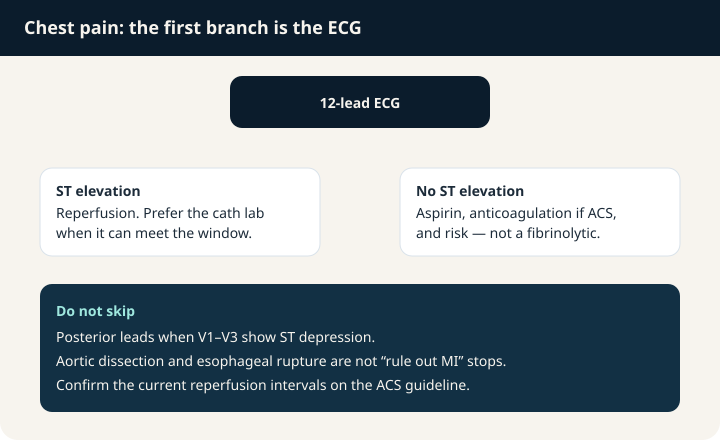

# Cardiovascular

## Framework

The feed has the single decisions. This is the order: ECG, stability, then the guideline drug.

**Blood pressure, 2025 AHA/ACC**

| Reading | Meaning |
| --- | --- |
| Under 120 and under 80 | Normal |
| 120–129 and under 80 | Elevated |
| 130–139 or 80–89 | Stage 1 |
| 140 or 90 and above | Stage 2 |

The treatment goal in that guideline is under 130/80 mm Hg. Start medicine at an average of 130/80 or higher when the patient has clinical cardiovascular disease, diabetes, CKD, or a PREVENT 10-year risk of 7.5% or higher. If risk is under 7.5% and those conditions are absent, lifestyle for 3 to 6 months, then medicine if still at or above 130/80. First-line classes: thiazide-type diuretic, long-acting dihydropyridine calcium-channel blocker, ACE inhibitor, or ARB. Do not combine an ACE inhibitor with an ARB. ([2025 AHA/ACC high blood pressure guideline](https://www.ahajournals.org/doi/10.1161/CIR.0000000000001356))

**The syndromes**

| Syndrome | Next move that the stem is testing |
| --- | --- |
| ST elevation | Reperfusion. Prefer the cath lab when it can meet the guideline window. Do not choose a fibrinolytic when the stem says PCI is available in time. Confirm the current minute targets on the ACS guideline. |
| ST depression in V1–V3 | Posterior leads. This can be an occlusion. |
| Pressure, no ST elevation, rising troponin | NSTE-ACS. Aspirin, anticoagulation, and a risk decision about an early invasive strategy. Not a fibrinolytic. |
| Tear to the back, unequal arm pressures | Image the aorta. Do not send this patient for lytics. |
| HFrEF, euvolemic | Four drug classes: ARNI (or ACE inhibitor or ARB if an ARNI is not possible), evidence-based beta-blocker (carvedilol, metoprolol succinate, or bisoprolol), mineralocorticoid receptor antagonist when the kidney and potassium allow, and an SGLT2 inhibitor. Do not combine an ARNI with an ACE inhibitor. |
| Atrial fibrillation, stable | Anticoagulate at about 2% yearly stroke risk and above, which the 2023 AF guideline maps to CHA2DS2-VASc of 2 or more in men and 3 or more in women. A DOAC is preferred except for a mechanical valve or moderate to severe mitral stenosis. |

Unstable tachycardia is electricity. A stable narrow-complex tachycardia gets a vagal maneuver or adenosine if it is regular, and a rate-control drug if it is fibrillation and the blood pressure allows.

## Checklist

- [ ] ECG before the troponin story changes your first order.
- [ ] BP goal under 130/80 in the 2025 guideline, with the PREVENT exceptions above.
- [ ] Four HFrEF drugs. Never an ACE inhibitor plus an ARNI.
- [ ] DOAC over warfarin unless the valve exception is in the stem.
- [ ] Dissection is imaging, not fibrinolysis.

## Common traps

- Fibrinolysis when the cath lab is available in time.
- Diltiazem for a reduced ejection fraction.
- Treating a blood pressure of 180 without symptoms as an intravenous emergency. Without organ damage, use oral treatment and follow-up.

## Practice this in the Qbank

The bank has a Step 2 cardiology block. Open a [Step 2 CK block](/question-bank?field=usmle-step-2&mode=bank&count=25&pace=timed&subjectId=mixed) and say "ECG, stability, guideline drug" before each answer.

## Sources

[2025 AHA/ACC high blood pressure guideline](https://www.ahajournals.org/doi/10.1161/CIR.0000000000001356). Heart-failure drug classes follow the 2022 AHA/ACC/HFSA heart failure guideline, which remains the ACC/AHA heart-failure document used for the four-drug frame. Atrial fibrillation anticoagulation follows the 2023 ACC/AHA/ACCP/HRS guideline's risk threshold. Confirm the current ACS reperfusion intervals on the ACC/AHA ACS guideline before you rely on a minute number. Outline: [Step 2 CK content outline](https://www.usmle.org/exam-resources/step-2-ck-materials/step-2-ck-content-outline-and-specifications).
