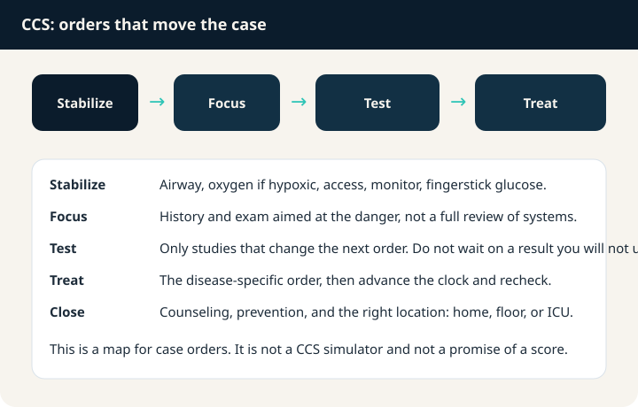

# CCS orders

## Framework

This is not a simulator. It is the sequence that CCS-style items and the real cases both reward.

| Moment | Orders that are often missing |
| --- | --- |
| First screen, sick | Oxygen if hypoxic, intravenous access, monitor, fingerstick glucose, pregnancy test when it would change a drug. |
| After the emergency | Focused exam. Do not spend the clock on a review of systems while the pressure is falling. |
| Tests | Only tests that change the next order. A panel you will not look at is not thorough. It is delay. |
| Treatment | The disease-specific order, then advance the clock to when that order should have worked. |
| Recheck | Repeat the vital sign or the lab that proved the emergency. A single order is not a case. |
| Close | Counseling, the vaccine or screen that is due, follow-up, and the right bed: home, floor, or intensive care. |

**Location**

| Patient | Where |
| --- | --- |
| Airway threat, shock, unstable arrhythmia | Intensive care. Do not discharge. |
| Needs a drip or an operation today | Stay. Consult the person who does that procedure. |
| Stable, diagnosis clear, oral therapy, follow-up exists | Home is allowed. Name the follow-up. |
| Unsafe at home, or cannot swallow the drug | Do not send them because the disease is "not ICU." |

Advance the clock when you are waiting for a result or a treatment effect. Do not advance it past an unstable vital sign you have not treated.

## Checklist

- [ ] Glucose and, when relevant, a pregnancy test early.
- [ ] Treat, then recheck the number that scared you.
- [ ] Advance time on purpose.
- [ ] Counsel and prevent before you end a stable case.
- [ ] Match the bed to the airway and the pressure, not to the length of the diagnosis.

## Common traps

- Ordering every imaging study before oxygen.
- Discharging chest pain you have not risk-stratified.
- Forgetting isolation for a cough that might be tuberculosis.
- Ending the case on the diagnosis without a follow-up visit.

## Practice this in the Qbank

Use the Step 3 CCS-style drill, then a [Step 3 block](/question-bank?field=usmle-step-3&mode=bank&count=25&pace=timed&subjectId=mixed). Write five orders and one recheck for each case. The drill is practice, not the NBME interface.

## Sources

[USMLE Step 3 materials](https://www.usmle.org/exam-resources/step-3-materials/step-3-content-outline-and-specifications) describe CCS as part of Day 2. The sequence here is a study map for order of operations. It is not an official scoring rubric, and this product does not include the Primum software.
